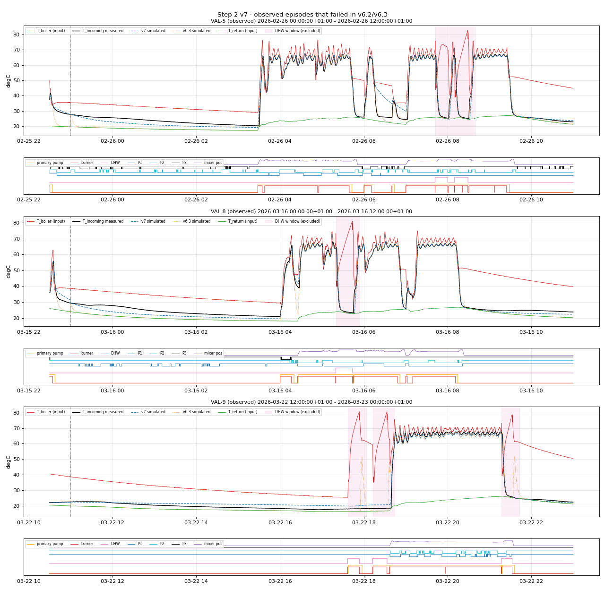
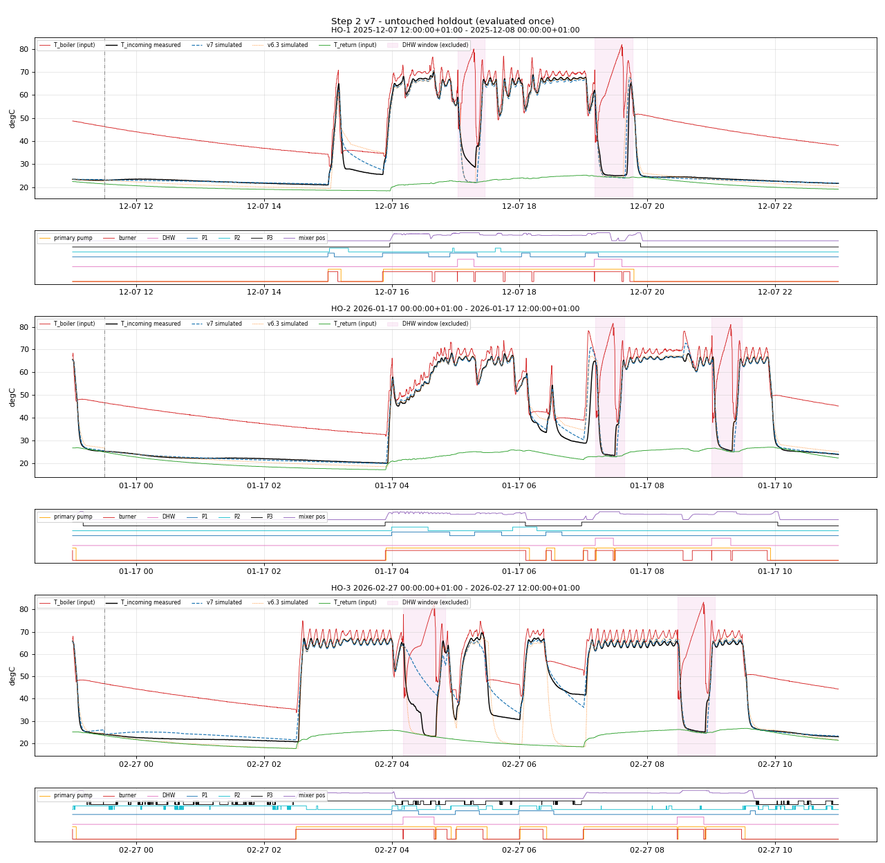

# Step 2 Report v7: Primary Heat Exchanger Dynamics (T_boiler -> T_incoming)

**Project:** ESP32 floor-heating HIL simulator - parameter extraction  
**Step / version:** Step 2, v7.0 (self-contained; supersedes v6.3)  
**Generated:** 2026-10-29 10:36:48 by `simulation/step2/step2_hx_dynamics_v7.py`  
**Model code:** `simulation/step2/hx_model_v7.py`; data access `simulation/common/plantdata.py`  
**Database:** `analysis/heatpumps.duckdb` (read-only)  
**Git HEAD at generation:** `4546af22c7a00a8ad0847dc088ada2e01b04e80f`

## 0. Summary

**Holdout result: FAIL** (1 of 6 frozen gates pass). The holdout (HO-1..HO-3) was selected from telemetry only, frozen with the gates before any v7 model code existed, and evaluated once after the parameter freeze.

| Suite | Metric | Gate | Actual | Result | Margin | Margin % | Note |
|---|---|---|---|---|---|---|---|
| space_heating | Mean episode RMSE (degC) | < 1.25 | 2.0519 | FAIL | -0.8019 | -64.2% |  |
| space_heating | Pooled RMSE (degC) | < 1.5 | 2.0932 | FAIL | -0.5932 | -39.5% |  |
| space_heating | Mean episode MAE (degC) | < 0.85 | 1.0176 | FAIL | -0.1676 | -19.7% |  |
| space_heating | Minimum per-episode R2 | > 0.9 | 0.9850 | PASS | 0.0850 | +9.4% |  |
| dhw | DHW pooled RMSE (degC) | < 4.5 | 9.0115 | FAIL | -4.5115 | -100.3% |  |
| dhw | DHW minimum per-episode R2 | > 0.9 | 0.0796 | FAIL | -0.8204 | -91.2% |  |

On the same TUNE blocks and scoring, v7 reaches a pooled RMSE of 3.727 degC versus 5.456 degC for the v6.3 model (mean episode MAE 1.413 vs 2.653 degC). On the holdout space-heating suite v7 reaches 2.093 degC pooled RMSE; the v6.3 model on the same samples is listed in Section 7.

Main physical findings (Section 2), each identified on FIT data:

1. When the boiler primary pump stops, T_incoming is set by the *secondary* flow through the fork, not by T_return.  The floor branch draws water through the fork only in proportion to the mixer opening; with the mixer closed and only the floor pump running the fork is stagnant.  Radiator circuits flush the fork with their own (latent) loop temperature.
2. The stagnant HX/fork water keeps a heat store that decays over tens of minutes; it is what v6.x missed when it relaxed T_incoming to T_return within minutes (VAL-5/8/9 failures).
3. The boiler's internal DHW/CH diverter has a memory: after a DHW cycle the HX primary stays isolated until the next space-heating burner firing, and the diverter then needs 93 s to deliver heat to the HX.
4. The T_incoming sensor reading lags the water by about 70 s (thermowell).

## 1. Data, split and protocol

* Heating season only (2025-12-02 .. 2026-05-17; summer excluded per Step 1).
* 10 s causal zero-order-hold grid; each sample carries the age of the last raw report.  T_incoming samples with age > 900 s are not scored (Step 1 outage rule).
* Pump states: raw power >= 2.0 W, then the Step 1 canonical centred 5-minute majority filter (31 samples).  This is an offline identification filter; in the HIL the simulator receives the relay states directly.
* Episodes are 12-hour blocks aligned to 00:00/12:00 local time.  Each block contains its own 30-minute warm-up: the model starts at the block start with all states set to the measured T_incoming, the sensor state is re-anchored at minute 30, and only minutes 30..720 are scored.  Blocks are therefore strictly disjoint *including warm-ups*.  A block ends at min(start + 12 h, next block start); this truncates 1 block(s) at the DST change (2026-03-29T13:00:00+02:00).
* Split (from `holdout_v7.json`, committed before modelling): FIT = blocks on even local day ordinals (156 blocks, 638,056 scored samples), TUNE = odd ordinals (156 blocks, 639,275 samples), holdout 3 blocks.  Blocks overlapping a previously observed validation window (VAL-1..VAL-9 of v5-v6.3, incl. their 30-min warm-ups) or within 6 h of a holdout block are excluded.
* Disjointness of all 324 FIT/TUNE/holdout/observed windows and the 6 h holdout buffer are asserted in `main()` before any computation.
* Parameters are identified on FIT only.  TUNE is used for structure decisions (ablations) and is never fitted.  The holdout is untouched until Section 6.

| Provenance | Value |
|---|---|
| holdout_v7.json SHA-256 | `4b4519793961a97f02aad3d82734bdcd150ab788405a49292d0066db1e7e9e70` |
| gates_v7.json SHA-256 | `151d16ab13c42d5ddbaece4889545573557ad27aa63d695f8f1cf409b383db98` |
| Parameter dict SHA-256 (frozen before holdout) | `441cf1d420244a55e753f7ab115c705ba64c2a1bb749625a2d0b86a56aa900a7` |
| Holdout first evaluated | 2026-10-29 10:36:48 |
| Holdout re-evaluated in this run (same parameters, reproducibility check) | no (first evaluation) |

## 2. Model

Discrete-time grey-box model, DT = 10 s.  States: T (water at the T_incoming sensor), Ts (sensor reading), Tp (primary water entering the HX), H (HX body / stagnant-water heat store), R (radiator-loop return water, latent), a primary-pipe plug-flow ring, and the diverter memory `div`.

```
secondary flow through the fork:  F_f = P3 * pos/100,  F_r = q1*P1 + q2*P2,  F = F_f + F_r
div := 1 while ww = 1; div := 0 at the first burner firing >= 30 s after ww falls
ACT  (pmod > 0, ww = 0, div = 0, >= div_travel_s since div cleared):
      ring: pop oldest cell, push T_boiler;  Tp += a(tau_p) * (popped - Tp)
      T  += a(tau_hx) * (T_ret + eps_r * (Tp - T_ret) - T)      eps_r: A / B / C / N
      H  += a(tau_hc) * (T_ret + k_hc * (T - T_ret) - H)
HOLD (first dhw_hold_s of a DHW divert): states held
OFF  (all other samples, incl. DHW divert):
      Tmix = (F_f * T_ret + F_r * R) / F
      T  += (DT*F/V * (Tmix - T) + DT/tau_fn * (H - T)) / (1 + DT*F/V + DT/tau_fn)
      H  += a(tau_h) * (amb + k_b' * (T_boiler - amb) - H),  k_b' = k_b_park if div else k_b
      ring cells += a(tau_pipe) * (T - cell)
R:   += a(tau_rc) * (T - R) in ACT with a radiator pump, else += a(tau_rd) * (amb - R)
Ts:  += a(tau_s) * (T - Ts)      (model output)
a(tau) = DT / (tau + DT);  amb = T_room + d_amb
```

Physical basis of each element (evidence on FIT data, see `v7_notes.md` for the exploration log):

* *Flushing by secondary flow:* after a primary stop with the mixer open, T_incoming collapses to T_return within minutes; with the mixer closed it does not.  A decision tree on FIT primary-stop events separates the two cases by the mixer position after the stop (exploration log in `v7_notes.md`; the ablation in Section 4.2 is the in-run evidence).
* *Heat store:* with no secondary flow, T_incoming decays over tens of minutes and stays well above T_return while the boiler body is hot.
* *Diverter memory and travel:* after a DHW cycle, the median delay from primary-pump start to a 3 degC T_incoming rise is longer than after a plain pause (FIT onsets; numbers in the notes).
* *Primary pipe and sensor lag:* the start of a firing shows a delayed, smoothed rise.

## 3. Identification (FIT only)

Objective: mean squared simulation error of the sensor output over all scored FIT samples (free-run simulation, no re-anchoring inside the scored window).  Global search: SciPy differential evolution (seed 7, population 12, max 200 generations, log-scaled time constants) with L-BFGS-B polish.  Result: 65,100 evaluations, 200 generations, 712.8 s, FIT RMSE 2.838 degC; optimiser message: "Maximum number of iterations has been exceeded.".  Input staleness on FIT (T_boiler or T_return age > 900 s): 18.36 % of samples.

| Parameter | Value | Unit | Search range | Boundary | Meaning |
|---|---|---|---|---|---|
| `tau_p` | 1 | s | [1, 600] | lower bound | lag of the primary water entering the HX |
| `tau_hx` | 5 | s | [5, 600] | lower bound | HX secondary outlet time constant (ACT) |
| `eps_A` | 0.931115 | - | [0.7, 1.05] |  | HX effectiveness, floor pump only |
| `eps_B` | 0.926443 | - | [0.7, 1.05] |  | HX effectiveness, floor + radiator pump(s) |
| `eps_C` | 0.909702 | - | [0.7, 1.05] |  | HX effectiveness, radiator pump(s) only |
| `eps_N` | 0.802061 | - | [0.3, 1.05] |  | HX effectiveness, no secondary pump |
| `tau_hc` | 48.3784 | s | [30, 30000] |  | heat-store charging time constant (ACT) |
| `k_hc` | 0 | - | [0, 1.1] | lower bound | heat-store charge level above T_return (ACT) |
| `V` | 62.2875 | s | [5, 3000] |  | flushing volume / unit flow (floor full open = 1) |
| `q1` | 0 | - | [0, 5] | lower bound | radiator circuit 1 flow through the fork |
| `q2` | 0.00384864 | - | [0, 5] | lower bound | radiator circuit 2 flow through the fork |
| `tau_fn` | 2537.38 | s | [100, 100000] |  | stagnant exchange sensor water <-> heat store |
| `tau_h` | 387.462 | s | [300, 100000] |  | heat-store relaxation time constant (OFF) |
| `k_b` | 0.141178 | - | [0, 1] |  | heat-store coupling to the boiler body (OFF) |
| `k_b_park` | 0.0677531 | - | [0, 1] |  | same, diverter parked on DHW |
| `tau_rc` | 30000 | s | [60, 30000] | upper bound | radiator-loop charging time constant |
| `tau_rd` | 7440.33 | s | [300, 100000] |  | radiator-loop cooling time constant |
| `dhw_hold_s` | 30.5505 | s | [0, 300] |  | state hold at the start of a DHW divert |
| `d_amb` | 0.557196 | degC | [-4, 4] |  | ambient offset relative to the room sensor |
| `L_pipe` | 11.7886 | s | [0, 630] |  | primary pipe plug-flow transport delay |
| `tau_pipe` | 2050.07 | s | [10, 100000] |  | stagnant primary pipe equilibration |
| `div_travel_s` | 93.2195 | s | [0, 600] |  | DHW->CH diverter travel time |
| `tau_s` | 70.4302 | s | [1, 300] |  | T_incoming sensor (thermowell) lag |

Boundary-limited parameters: `tau_p`, `tau_hx`, `k_hc`, `q1`, `q2`, `tau_rc`.  A boundary value means the corresponding element is switched off or saturated by the data (for example a time constant at its lower bound acts as an instantaneous step, `q2 = 0` means radiator circuit 2 does not flush the fork measurably).  These are reported as is and are not extrapolated.

## 4. FIT and TUNE performance

| Set | Blocks | Scored samples | Mean RMSE | Pooled RMSE | Mean MAE | Median R2 | Min R2 |
|---|---|---|---|---|---|---|---|
| FIT (v7) | 156 | 638,056 | 2.183 | 2.838 | 1.269 | 0.977 | -335.636 |
| TUNE (v7) | 156 | 639,275 | 2.317 | 3.727 | 1.413 | 0.979 | -432.849 |
| TUNE (v6.3 model) | 156 | 639,275 | 4.298 | 5.456 | 2.653 | 0.902 | -4657.084 |

The minimum R2 is strongly negative on both sets because some blocks are almost isothermal (no heating; T_incoming varies by a few tenths of a degree), where R2 is not informative.  The median R2 and the RMSE/MAE describe typical behaviour.

### 4.1 TUNE error by mode and time in mode

| Mode | Time in mode | Samples | RMSE | Bias (sim-meas) | Share of TUNE SSE |
|---|---|---|---|---|---|
| active | all | 210,119 | 3.247 | -0.205 | 24.9% |
| active | 0-2 min | 7,203 | 5.723 | -0.540 | 2.7% |
| active | 2-10 min | 25,179 | 4.762 | -0.057 | 6.4% |
| active | 10-30 min | 38,684 | 1.411 | -0.576 | 0.9% |
| active | >30 min | 139,053 | 3.095 | -0.111 | 15.0% |
| off_flow | all | 179,025 | 4.615 | -0.219 | 42.9% |
| off_flow | 0-2 min | 23,157 | 3.128 | -0.137 | 2.6% |
| off_flow | 2-10 min | 36,637 | 4.377 | -0.017 | 7.9% |
| off_flow | 10-30 min | 32,186 | 5.589 | -0.510 | 11.3% |
| off_flow | >30 min | 87,045 | 4.647 | -0.218 | 21.2% |
| off_stagnant | all | 220,974 | 3.316 | -0.001 | 27.4% |
| off_stagnant | 0-2 min | 23,119 | 3.337 | -0.034 | 2.9% |
| off_stagnant | 2-10 min | 42,418 | 3.789 | 0.326 | 6.9% |
| off_stagnant | 10-30 min | 49,953 | 4.400 | -0.030 | 10.9% |
| off_stagnant | >30 min | 105,484 | 2.379 | -0.112 | 6.7% |
| dhw | all | 28,450 | 3.841 | 0.009 | 4.7% |
| dhw | 0-2 min | 2,829 | 3.577 | -0.717 | 0.4% |
| dhw | 2-10 min | 11,321 | 4.331 | 0.324 | 2.4% |
| dhw | 10-30 min | 14,074 | 3.481 | -0.085 | 1.9% |
| dhw | >30 min | 226 | 1.565 | -0.826 | 0.0% |
| dhw_hold | all | 707 | 1.773 | 0.003 | 0.0% |
| dhw_hold | 0-2 min | 707 | 1.773 | 0.003 | 0.0% |

Transitions (the first 30 minutes of each mode) carry 57 % of the TUNE squared error.  Settled active heating (> 30 min) has an RMSE of 3.095 degC.  Most of the remaining error is transition timing: the boiler signals (burner %, pump %) are event-reported by the EMS bus with irregular latency; for example, a timing error of half a minute on a swing of several tens of degrees produces errors of the order of ten degrees for that half minute.

### 4.2 Structure check: refitted ablations (fit on FIT, scored on TUNE)

Each row removes one structural element (parameters held at the stated values), refits the remaining parameters on FIT with L-BFGS-B from the v7 optimum, and scores TUNE.

| Removed element | TUNE pooled RMSE | TUNE mean MAE | Delta pooled vs v7 |
|---|---|---|---|
| no secondary flushing (V -> 1e9, q -> 0) | 4.480 | 2.212 | +0.752 |
| no diverter travel time | 3.722 | 1.415 | -0.005 |
| no sensor lag | 3.829 | 1.543 | +0.101 |
| no primary pipe delay | 3.727 | 1.413 | -0.000 |
| no boiler-body coupling (k_b = k_b_park = 0) | 3.754 | 1.445 | +0.026 |
| (none - full v7) | 3.727 | 1.413 | +0.000 |

A positive delta means the element improves out-of-sample (TUNE) accuracy.

## 5. Observed validation episodes (not sign-off evidence)

These windows were seen by earlier versions (VAL-1..VAL-7 since v5/v6.1, VAL-5 failed in v6.2, VAL-8/VAL-9 failed as the v6.3 holdout).  They are excluded from FIT/TUNE and reported for continuity only.  Each episode uses a 30-minute warm-up before its start.

| ID | Window | Scored | v7 RMSE | v7 MAE | v7 R2 | v6.3 RMSE | v6.3 MAE |
|---|---|---|---|---|---|---|---|
| VAL-1 | 2026-01-15 00:00 -> 05:00 | 1800 | 0.911 | 0.418 | 0.721 | 0.860 | 0.554 |
| VAL-2 | 2026-02-19 14:40 -> 17:25 | 990 | 0.472 | 0.340 | 0.988 | 0.993 | 0.835 |
| VAL-3 | 2026-01-13 05:00 -> 07:35 | 930 | 0.675 | 0.568 | 0.987 | 0.785 | 0.720 |
| VAL-4 | 2026-01-14 05:00 -> 07:30 | 900 | 0.787 | 0.702 | 0.980 | 1.070 | 1.028 |
| VAL-5 | 2026-02-26 00:00 -> 12:00 | 4320 | 3.180 | 1.745 | 0.970 | 3.436 | 2.511 |
| VAL-6 | 2026-02-18 05:50 -> 06:55 | 390 | 4.531 | 3.197 | 0.917 | 4.438 | 3.035 |
| VAL-7 | 2026-01-03 03:20 -> 03:50 | 180 | 0.449 | 0.411 | -0.502 | 0.395 | 0.374 |
| VAL-8 | 2026-03-16 00:00 -> 12:00 | 4320 | 1.913 | 1.459 | 0.987 | 3.421 | 2.675 |
| VAL-9 | 2026-03-22 12:00 -> 00:00 | 4320 | 1.623 | 1.394 | 0.993 | 3.688 | 2.100 |



## 6. Untouched holdout (evaluated once)

| ID | Window | SH scored | SH RMSE | SH MAE | SH R2 | Circ. DHW events | DHW scored | DHW RMSE | DHW R2 |
|---|---|---|---|---|---|---|---|---|---|
| HO-1 | 2025-12-07T12:00 -> 00:00 | 3769 | 1.460 | 0.777 | 0.994 | 2 | 371 | 6.670 | 0.732 |
| HO-2 | 2026-01-17T00:00 -> 12:00 | 3808 | 2.334 | 0.790 | 0.985 | 2 | 332 | 3.412 | 0.944 |
| HO-3 | 2026-02-27T00:00 -> 12:00 | 3693 | 2.362 | 1.485 | 0.985 | 2 | 447 | 12.781 | 0.080 |

Space-heating suite (all DHW windows [ww rise, ww fall + 600 s] excluded): mean episode RMSE 2.052, pooled RMSE 2.093, mean MAE 1.018 degC, per-episode R2 min 0.985 (pooled R2 0.988; pooled R2 is higher because pooling adds the between-episode variance).  DHW suite (circulating DHW windows): pooled RMSE 9.012 degC, min per-episode R2 0.080.



## 7. Comparison with v6.3 on the same samples

| Holdout | v7 SH RMSE | v6.3 SH RMSE | v7 SH MAE | v6.3 SH MAE | v7 DHW RMSE | v6.3 DHW RMSE |
|---|---|---|---|---|---|---|
| HO-1 | 1.460 | 2.987 | 0.777 | 1.707 | 6.670 | 8.094 |
| HO-2 | 2.334 | 2.674 | 0.790 | 1.407 | 3.412 | 1.955 |
| HO-3 | 2.362 | 6.505 | 1.485 | 3.212 | 12.781 | 5.135 |

The v6.3 model is run with its frozen parameters (`step2_params_v63.json`) and its own causal pump filter, re-anchored at the same sample as v7.

## 8. Use in the HIL simulator and limitations

* **Inputs in closed loop.** The HIL must provide T_boiler, burner and primary-pump state and the DHW flag from a boiler model (Phase 6), the pump relay states, the mixer position (from the Phase 4 actuator model) and T_return (Phase 5).  The v7 model was identified with measured inputs; its accuracy in closed loop also depends on those models.
* **Gate outcome.** The frozen gates were set before modelling; their outcome above is final for v7.  The error budget (Section 4.1) shows that settled active heating is reproduced with an RMSE of 3.095 degC on TUNE and that the residual is dominated by transitions, whose timing is limited by the event-driven boiler telemetry.
* **Unmeasured radiator loop.** The radiator return temperature is not measured; R is a latent state identified only through T_incoming.
* **Boundary-limited parameters** (Section 3) are not identifiable from this data set; the simulator should keep them at the reported values.
* **Mixer position** enters via the dead-reckoned `mixer_state` (drift about 2 % per Step 1).
* **No C++ export in this step.** The C++ implementation and its parity test are produced once for the integrated plant in Phase 6; `hx_model_v7.py` is written for a line-by-line port.

## 9. Reproduction

```bash
cd /home/gume/claude/HeatpumpsN
.venv/bin/python simulation/step2/select_holdout_v7.py   # Phase 0 (already frozen; do not rerun)
.venv/bin/python simulation/step2/step2_hx_dynamics_v7.py
```

Runtime of this run: 878.6 s.  Outputs: `step2_params_v7.json`, this report, `holdout_result_v7.json`, and the three PNG overlays in `simulation/step2/`.
