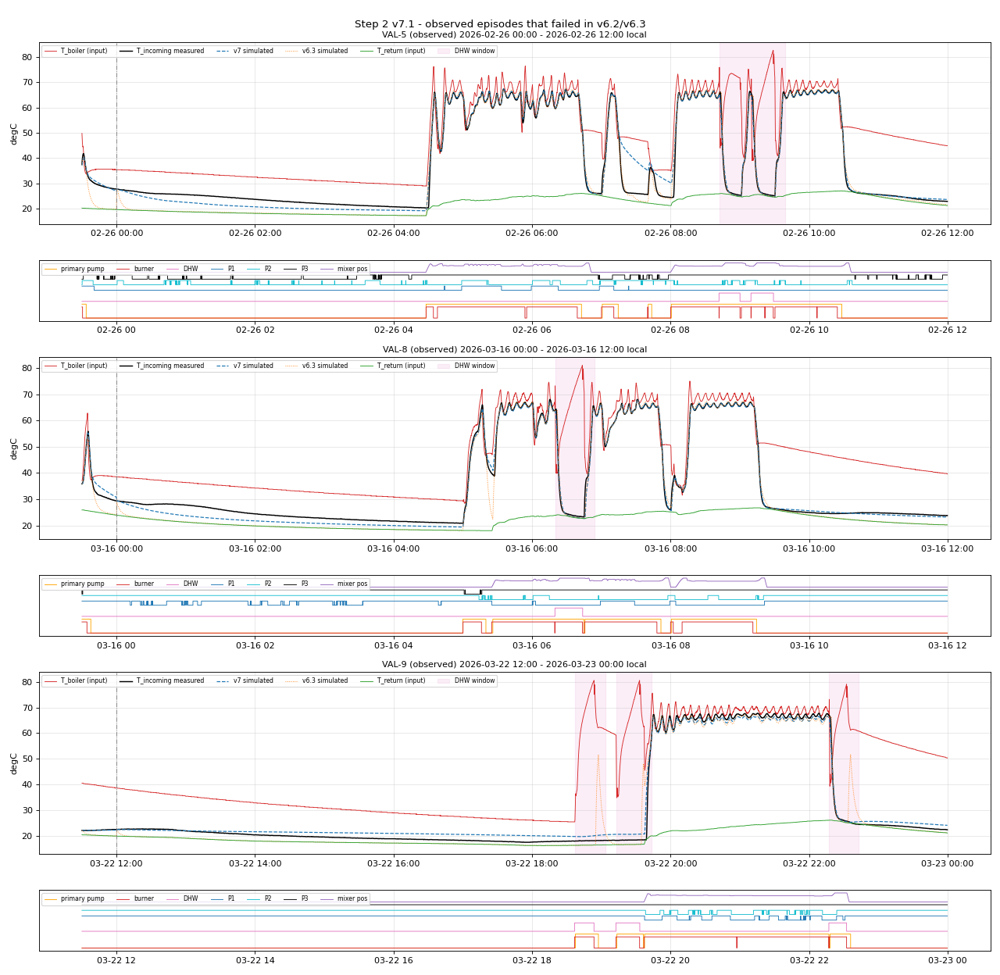
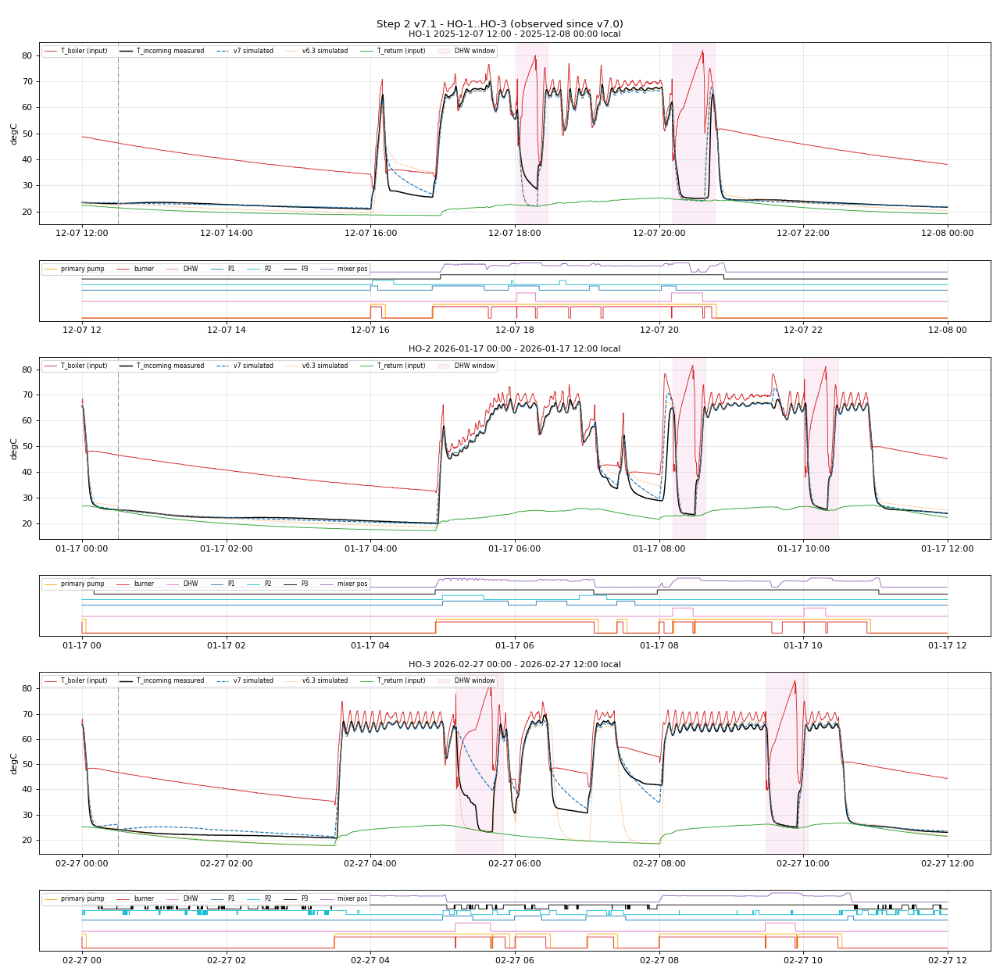
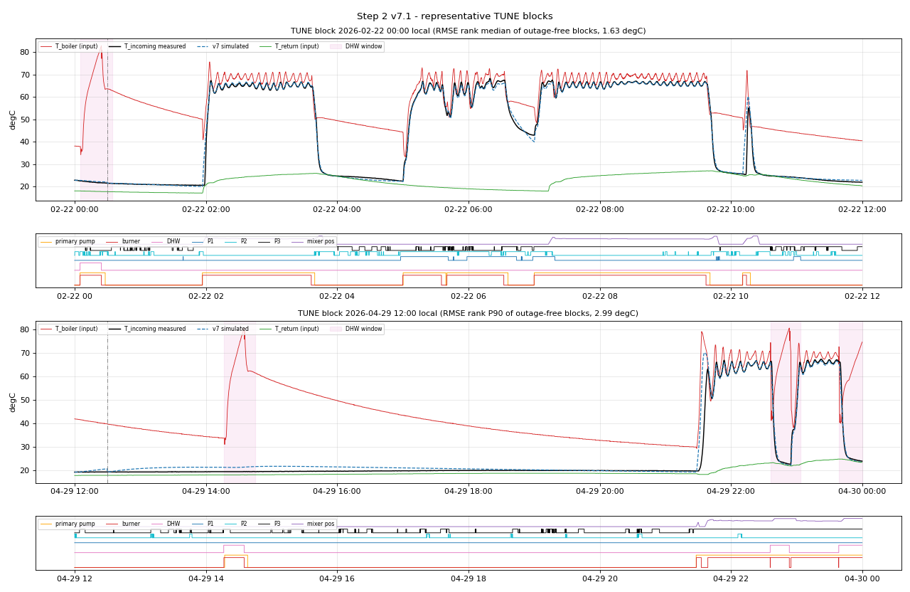

# Step 2 Report v7.1: Primary Heat Exchanger Dynamics (T_boiler -> T_incoming)

**Project:** ESP32 floor-heating HIL simulator - parameter extraction  
**Step / version:** Step 2, v7.1 (self-contained)  
**Generated:** 2026-10-29 11:21:50 by `simulation/step2/step2_hx_dynamics_v71.py`  
**Model code:** `simulation/step2/hx_model_v71.py`; data access `simulation/common/plantdata.py`  
**Database:** `analysis/heatpumps.duckdb` (read-only)  
**Git HEAD at generation:** `fc8cd0b7040e80ff7fa3c420872636dc80e9b0ca`

## 0. Summary

**Official holdout result (v7.0, evaluated once): FAIL** (1 of 6 frozen gates pass; space-heating pooled RMSE 2.093 degC against the 1.5 degC gate).  The holdout HO-1..HO-3 was selected from telemetry only and frozen together with the gates before any v7 model code existed.

v7.1 corrects a defect found in the audit of v7.0: boiler-telemetry outages were neither excluded from identification nor from scoring.  Because HO-1..HO-3 had already been evaluated with v7.0, they are **observed** episodes for v7.1 and cannot support a sign-off.  Their v7.1 scores against the frozen gates are reported for information:

| Suite | Metric | Gate | v7.1 (observed) | Result | Margin % | v7.0 (official) | v7.0 result |
|---|---|---|---|---|---|---|---|
| space_heating | Mean episode RMSE (degC) | < 1.25 | 1.9815 | FAIL | -58.5% | 2.0519 | FAIL |
| space_heating | Pooled RMSE (degC) | < 1.5 | 2.0189 | FAIL | -34.6% | 2.0932 | FAIL |
| space_heating | Mean episode MAE (degC) | < 0.85 | 0.9800 | FAIL | -15.3% | 1.0176 | FAIL |
| space_heating | Minimum per-episode R2 | > 0.9 | 0.9857 | PASS | +9.5% | 0.9850 | PASS |
| dhw | DHW pooled RMSE (degC) | < 4.5 | 8.4609 | FAIL | -88.0% | 9.0115 | FAIL |
| dhw | DHW minimum per-episode R2 | > 0.9 | 0.2263 | FAIL | -74.9% | 0.0796 | FAIL |

On the TUNE blocks (never fitted), v7.1 reaches a pooled RMSE of 2.089 degC and a mean episode MAE of 1.154 degC; the v6.3 model on the same samples gives 4.843 and 2.501 degC.

Physical findings supported by the identified parameters and the TUNE ablations (Section 4.2):

1. Secondary flow through the fork sets T_incoming whenever the primary is not delivering heat: the floor branch flushes the fork in proportion to P3 x mixer opening, so with the mixer closed the fork is stagnant.  The radiator circuits show no measurable flushing of the fork (q1 = 0, q2 = 0.00473).  Removing this element worsens TUNE pooled RMSE by +1.061 degC.
2. Stagnant fork/HX water exchanges with a heat store H (tau_fn = 2124 s); H relaxes with tau_h = 340 s towards ambient + 0.147 x (T_boiler - ambient) (0.068 with the diverter parked on DHW).  This slow decay is what v6.x missed (it relaxed T_incoming to T_return within minutes).
3. The T_incoming reading lags the water with tau_s = 75 s (thermowell); removing the lag changes TUNE pooled RMSE by +0.191 degC.
4. Elements removed by the pre-declared parsimony rule (TUNE improvement < 0.01 degC): no diverter travel time; no primary pipe delay.

## 1. Data, split and protocol

* Heating season only (2025-12-02 .. 2026-05-17; summer excluded per Step 1).
* 10 s causal zero-order-hold grid; each sample carries the age of the last raw report.
* **Input outages:** a sample is an outage when T_boiler (EMS bus, reported at least every few minutes while the gateway is alive) is older than 900 s.  During an outage all model states are held; at the first valid sample they are re-anchored to the measured T_incoming; the outage and the following 30 min are not scored.  Outage share: FIT 1.02 %, TUNE 1.79 % of samples.  T_return ages are not used for this rule: Home Assistant de-duplicates unchanged DS18B20 values, so long T_return ages occur in steady operation.
* T_incoming samples older than 900 s are not scored (Step 1 outage rule).
* Pump states: raw power >= 2.0 W, then the Step 1 centred 5-minute majority filter (31 samples) - an offline identification filter; the HIL receives relay states.
* Episodes are 12-hour blocks aligned to 00:00/12:00 local time, each with an internal 30-minute warm-up (states start at the measured T_incoming, the sensor state is re-anchored at minute 30, minutes 30..720 are scored).  Blocks are strictly disjoint including warm-ups.  A block ends at min(start + 12 h, next block start), which truncates 1 block(s) at the DST change (2026-03-29T13:00:00+02:00).
* Split (`holdout_v7.json`, committed before modelling): FIT = even local day ordinals (156 blocks, 628,489 scored samples), TUNE = odd ordinals (156 blocks, 624,250), HO-1..HO-3 (3 blocks).  Blocks overlapping a previously observed validation window (VAL-1..VAL-9, incl. 30-min warm-ups) or within 6 h of a holdout block are excluded.
* Disjointness of all 324 windows and the 6 h holdout buffer is asserted in `main()`.
* Parameters are identified on FIT only; TUNE is never fitted and is used for the structure (ablation / parsimony) decisions.

| Provenance | Value |
|---|---|
| holdout_v7.json SHA-256 | `4b4519793961a97f02aad3d82734bdcd150ab788405a49292d0066db1e7e9e70` |
| gates_v7.json SHA-256 | `151d16ab13c42d5ddbaece4889545573557ad27aa63d695f8f1cf409b383db98` |
| v7.0 parameter SHA-256 (official holdout evaluation) | `441cf1d420244a55e753f7ab115c705ba64c2a1bb749625a2d0b86a56aa900a7` |
| v7.0 holdout evaluated at | 2026-10-29 10:36:48 |
| v7.1 parameter SHA-256 | `014687537492c0a8445d53691af44109119a494a1b6a9acdd49b1f1e7d04b98c` |

## 2. Model

Discrete-time grey-box model, DT = 10 s.  States: T (water at the T_incoming sensor), Ts (sensor reading = model output), Tp (primary water entering the HX), H (HX body / stagnant water heat store), R (radiator-loop return water, latent), a primary-pipe plug-flow ring and the boiler diverter memory `div`.

```
secondary flow through the fork:  F_f = P3 * pos/100,  F_r = q1*P1 + q2*P2,  F = F_f + F_r
div := 1 while ww = 1; div := 0 at the first burner firing >= 30 s after ww falls
ACT  (pmod > 0, ww = 0, div = 0, >= div_travel_s since div cleared):
      ring: pop oldest cell, push T_boiler;  Tp += a(tau_p) * (popped - Tp)
      T  += a(tau_hx) * (T_ret + eps_r * (Tp - T_ret) - T)      eps_r: A / B / C / N
      H  += a(tau_hc) * (T_ret + k_hc * (T - T_ret) - H)
HOLD (first dhw_hold_s of a DHW divert): states held
OFF  (all other samples, incl. DHW divert):
      Tmix = (F_f * T_ret + F_r * R) / F
      T  += (DT*F/V * (Tmix - T) + DT/tau_fn * (H - T)) / (1 + DT*F/V + DT/tau_fn)
      H  += a(tau_h) * (amb + k_b' * (T_boiler - amb) - H),  k_b' = k_b_park if div else k_b
      ring cells += a(tau_pipe) * (T - cell)
R:   += a(tau_rc) * (T - R) in ACT with a radiator pump, else += a(tau_rd) * (amb - R)
Ts:  += a(tau_s) * (T - Ts)
a(tau) = DT / (tau + DT);  amb = T_room + d_amb;  regimes: A floor only, B floor + radiator,
C radiator only, N no secondary pump
```

How each element was found (exploration on FIT, comparison on TUNE; log in `v7_notes.md`): the T_incoming collapse after a primary stop depends on the mixer position (flushing); without secondary flow T_incoming decays over tens of minutes (heat store); after DHW the HX stays decoupled until the next CH firing (diverter memory); firing onsets look delayed and smoothed (candidates: primary pipe delay, diverter travel time, sensor lag).  Section 4.2 tests every candidate out of sample; the parsimony rule removed: no diverter travel time; no primary pipe delay.

## 3. Identification (FIT only)

Objective: mean squared free-run simulation error of the sensor output over all scored FIT samples.  Global search: SciPy differential evolution (seed 7, population 12, max 200 generations, log-scaled time constants) with L-BFGS-B polish: 70,500 evaluations, 200 generations, 834.4 s, FIT RMSE 2.193 degC ("Maximum number of iterations has been exceeded.").  Elements removed by the parsimony rule are then fixed and the remaining parameters refitted on FIT (L-BFGS-B).

| Parameter | Final value | Full-structure fit | Unit | Search range | Note | Meaning |
|---|---|---|---|---|---|---|
| `tau_p` | 1 | 1.16201 | s | [1, 600] | lower bound | lag of the primary water entering the HX |
| `tau_hx` | 5 | 5.0361 | s | [5, 600] | lower bound | HX secondary outlet time constant (ACT) |
| `eps_A` | 0.930776 | 0.933245 | - | [0.7, 1.05] |  | HX effectiveness, floor pump only |
| `eps_B` | 0.926458 | 0.927675 | - | [0.7, 1.05] |  | HX effectiveness, floor + radiator pump(s) |
| `eps_C` | 0.926751 | 0.917612 | - | [0.7, 1.05] |  | HX effectiveness, radiator pump(s) only |
| `eps_N` | 0.898068 | 0.888322 | - | [0.3, 1.05] |  | HX effectiveness, no secondary pump |
| `tau_hc` | 30.4547 | 31.2031 | s | [30, 30000] | lower bound | heat-store charging time constant (ACT) |
| `k_hc` | 0 | 0.0028325 | - | [0, 1.1] | lower bound | heat-store charge level above T_return (ACT) |
| `V` | 63.559 | 67.8508 | s | [5, 3000] |  | flushing volume / unit flow (floor full open = 1) |
| `q1` | 0 | 0.00228693 | - | [0, 5] | lower bound | radiator circuit 1 flow through the fork |
| `q2` | 0.0047322 | 0.00749132 | - | [0, 5] | lower bound | radiator circuit 2 flow through the fork |
| `tau_fn` | 2123.63 | 2296.83 | s | [100, 100000] |  | stagnant exchange sensor water <-> heat store |
| `tau_h` | 339.576 | 337.399 | s | [300, 100000] |  | heat-store relaxation time constant (OFF) |
| `k_b` | 0.147315 | 0.137624 | - | [0, 1] |  | heat-store coupling to the boiler body (OFF) |
| `k_b_park` | 0.0682655 | 0.0613056 | - | [0, 1] |  | same, diverter parked on DHW |
| `tau_rc` | 1421.62 | 1502.92 | s | [60, 30000] |  | radiator-loop charging time constant |
| `tau_rd` | 6900.55 | 3804.29 | s | [300, 100000] |  | radiator-loop cooling time constant |
| `dhw_hold_s` | 22.6771 | 22.6771 | s | [0, 300] |  | state hold at the start of a DHW divert |
| `d_amb` | 0.49178 | 0.785248 | degC | [-4, 4] |  | ambient offset relative to the room sensor |
| `L_pipe` | 0 | 8.97569 | s | [0, 630] | fixed (parsimony) | primary pipe plug-flow transport delay |
| `tau_pipe` | 677.609 | 925.094 | s | [10, 100000] |  | stagnant primary pipe equilibration |
| `div_travel_s` | 0 | 101.182 | s | [0, 600] | fixed (parsimony) | DHW->CH diverter travel time |
| `tau_s` | 75.2722 | 68.2148 | s | [1, 300] |  | T_incoming sensor (thermowell) lag |

Boundary-limited (not fixed by parsimony): `tau_p`, `tau_hx`, `tau_hc`, `k_hc`, `q1`, `q2`.  A time constant at its lower bound acts as an immediate step; a coupling or flow at 0 means the element is not supported by the data; a time constant at its upper bound means the process is slower than the 12-hour blocks resolve.  These values are used as is.
Interpretation notes: with q1 = 0 and q2 = 0.00473 the radiator-loop state R has practically no path to T, so `tau_rc` and `tau_rd` are **not identifiable**; their values are numerically fitted but carry no physical meaning and may be replaced by any value in the simulator; `L_pipe` = 0 is implemented as a single 10-s ring cell (the ring length is clamped to >= 1), i.e. a one-step delay whose stagnant content relaxes toward T with `tau_pipe` = 678 s; this is the residual pipe element after parsimony; `div_travel_s` = 0: the diverter memory (decoupling until the next CH firing) remains, the travel delay does not.

## 4. FIT and TUNE performance

| Set | Blocks | Scored samples | Mean RMSE | Pooled RMSE | Mean MAE | Median R2 | Min R2 |
|---|---|---|---|---|---|---|---|
| FIT (v7.1) | 156 | 628,489 | 1.968 | 2.202 | 1.187 | 0.978 | -343.444 |
| TUNE (v7.1) | 156 | 624,250 | 1.905 | 2.089 | 1.154 | 0.980 | -429.815 |
| TUNE (v6.3 model) | 156 | 624,250 | 4.088 | 4.843 | 2.501 | 0.905 | -4713.152 |

Min R2 is not informative for nearly isothermal blocks (no heating, T_incoming varies by tenths of a degree); median R2, RMSE and MAE describe typical behaviour.

### 4.1 TUNE error by mode and time in mode

| Mode | Time in mode | Samples | RMSE | Bias (sim-meas) | Share of TUNE SSE |
|---|---|---|---|---|---|
| active | all | 208,855 | 2.223 | -0.192 | 37.9% |
| active | 0-2 min | 7,072 | 4.885 | 0.317 | 6.2% |
| active | 2-10 min | 24,913 | 5.099 | 0.334 | 23.8% |
| active | 10-30 min | 38,490 | 1.000 | -0.356 | 1.4% |
| active | >30 min | 138,380 | 1.132 | -0.266 | 6.5% |
| off_flow | all | 170,669 | 1.873 | 0.366 | 22.0% |
| off_flow | 0-2 min | 22,315 | 2.037 | 0.188 | 3.4% |
| off_flow | 2-10 min | 35,291 | 2.398 | 0.597 | 7.5% |
| off_flow | 10-30 min | 31,154 | 2.084 | 0.308 | 5.0% |
| off_flow | >30 min | 81,909 | 1.432 | 0.337 | 6.2% |
| off_stagnant | all | 215,979 | 1.759 | 0.068 | 24.5% |
| off_stagnant | 0-2 min | 22,608 | 1.926 | 0.242 | 3.1% |
| off_stagnant | 2-10 min | 41,584 | 2.249 | 0.510 | 7.7% |
| off_stagnant | 10-30 min | 48,896 | 1.844 | 0.062 | 6.1% |
| off_stagnant | >30 min | 102,891 | 1.421 | -0.146 | 7.6% |
| dhw | all | 28,283 | 3.867 | -0.072 | 15.5% |
| dhw | 0-2 min | 2,780 | 3.756 | -1.067 | 1.4% |
| dhw | 2-10 min | 11,127 | 4.377 | 0.258 | 7.8% |
| dhw | 10-30 min | 14,141 | 3.462 | -0.122 | 6.2% |
| dhw | >30 min | 235 | 2.064 | -0.976 | 0.0% |
| dhw_hold | all | 464 | 1.972 | 0.019 | 0.1% |
| dhw_hold | 0-2 min | 464 | 1.972 | 0.019 | 0.1% |

The first 30 minutes after each mode change carry 80 % of the TUNE squared error; settled active heating (> 30 min) has an RMSE of 1.132 degC.  Transition timing is limited by the event-driven EMS telemetry (burner and pump modulation are reported on change with irregular latency): a timing error of half a minute on a swing of several tens of degrees produces errors of about ten degrees for that half minute.

### 4.2 Structure check: refitted ablations (fit on FIT, scored on TUNE)

Each row removes one element of the full structure (parameters held at the stated values), refits the remaining parameters on FIT (L-BFGS-B from the full optimum) and scores TUNE.  Pre-declared parsimony rule: an element whose removal worsens TUNE pooled RMSE by less than 0.01 degC is removed from the final model.

| Removed element | TUNE pooled RMSE | TUNE mean MAE | Delta vs full | Decision |
|---|---|---|---|---|
| no secondary flushing (V -> 1e9, q -> 0) | 3.159 | 1.945 | +1.061 | kept |
| no diverter travel time | 2.089 | 1.154 | -0.008 | removed |
| no sensor lag | 2.288 | 1.275 | +0.191 | kept |
| no primary pipe delay | 2.100 | 1.148 | +0.002 | removed |
| no boiler-body coupling (k_b = k_b_park = 0) | 2.181 | 1.235 | +0.084 | kept |
| (none - full structure) | 2.098 | 1.138 | +0.000 |  |
| final v7.1 (after parsimony refit) | 2.089 | 1.154 | -0.008 |  |

## 5. Observed validation episodes (not sign-off evidence)

Seen by earlier versions (VAL-1..VAL-7 since v5/v6.1, VAL-5 failed in v6.2, VAL-8/VAL-9 failed as the v6.3 holdout).  Excluded from FIT/TUNE; 30-minute warm-up before each start.

| ID | Window | Scored | v7.1 RMSE | v7.1 MAE | v7.1 R2 | v6.3 RMSE | v6.3 MAE |
|---|---|---|---|---|---|---|---|
| VAL-1 | 2026-01-15 00:00 -> 05:00 | 1800 | 0.898 | 0.438 | 0.729 | 0.860 | 0.554 |
| VAL-2 | 2026-02-19 14:40 -> 17:25 | 990 | 0.506 | 0.359 | 0.986 | 0.993 | 0.835 |
| VAL-3 | 2026-01-13 05:00 -> 07:35 | 930 | 0.708 | 0.573 | 0.986 | 0.785 | 0.720 |
| VAL-4 | 2026-01-14 05:00 -> 07:30 | 900 | 0.812 | 0.720 | 0.979 | 1.070 | 1.028 |
| VAL-5 | 2026-02-26 00:00 -> 12:00 | 4320 | 3.171 | 1.774 | 0.970 | 3.436 | 2.511 |
| VAL-6 | 2026-02-18 05:50 -> 06:55 | 390 | 4.133 | 2.874 | 0.931 | 4.438 | 3.035 |
| VAL-7 | 2026-01-03 03:20 -> 03:50 | 180 | 0.404 | 0.369 | -0.217 | 0.395 | 0.374 |
| VAL-8 | 2026-03-16 00:00 -> 12:00 | 4320 | 1.801 | 1.335 | 0.989 | 3.421 | 2.675 |
| VAL-9 | 2026-03-22 12:00 -> 00:00 | 4320 | 1.814 | 1.510 | 0.991 | 3.688 | 2.100 |



## 6. HO-1..HO-3 (observed since v7.0)

| ID | Window | SH scored | SH RMSE | SH MAE | SH R2 | v6.3 SH RMSE | Circ. DHW | DHW RMSE | DHW R2 | v6.3 DHW RMSE |
|---|---|---|---|---|---|---|---|---|---|---|
| HO-1 | 2025-12-07T12:00 -> 00:00 | 3769 | 1.429 | 0.762 | 0.994 | 2.987 | 2 | 7.276 | 0.681 | 8.094 |
| HO-2 | 2026-01-17T00:00 -> 12:00 | 3808 | 2.273 | 0.791 | 0.986 | 2.674 | 2 | 1.979 | 0.981 | 1.955 |
| HO-3 | 2026-02-27T00:00 -> 12:00 | 3693 | 2.242 | 1.387 | 0.987 | 6.505 | 2 | 11.718 | 0.226 | 5.135 |

Space-heating suite (DHW windows [ww rise, ww fall + 600 s] excluded): mean RMSE 1.981, pooled RMSE 2.019, mean MAE 0.980 degC, min per-episode R2 0.986 (pooled R2 0.989, inflated by between-episode variance).  Circulating-DHW suite: pooled RMSE 8.461 degC, min per-episode R2 0.226.



## 7. Representative TUNE blocks



## 8. Use in the HIL simulator and limitations

* **Closed-loop inputs.** The HIL must supply T_boiler, burner and primary-pump state and the DHW flag (boiler model, Phase 6), pump relay states, mixer position (Phase 4 actuator) and T_return (Phase 5).  Accuracy in closed loop also depends on those models.
* **Acceptance.** The only untouched evaluation is the v7.0 holdout, which FAILED the frozen gates.  v7.1 is the recommended parameter set (it removes an identification bias), but its holdout numbers are observed.  Remaining error is concentrated in transitions (Section 4.1).
* **DHW divert.** The circulating-DHW plunge is the weakest part of the model (observed DHW pooled RMSE 8.461 degC).  For HIL purposes the qualitative behaviour (T_incoming falls during DHW and recovers afterwards) is reproduced, but the plunge rate can be wrong by several minutes.
* **Unmeasured radiator loop.** R is a latent state identified only through T_incoming.
* **Mixer position** enters via the dead-reckoned `mixer_state` (drift about 2 %, Step 1).
* **No C++ export in this step.** The integrated plant gets one C++ port with a parity test in Phase 6; `hx_model_v71.py` is written for a line-by-line port.

## 9. Reproduction

```bash
cd /home/gume/claude/HeatpumpsN
.venv/bin/python simulation/step2/step2_hx_dynamics_v71.py   # needs holdout_result_v7.json
```

Runtime: 1099.7 s.  Outputs in `simulation/step2/`: `step2_params_v71.json`, this report, `holdout_observed_v71.json` and three PNG overlays.  The official v7.0 holdout run is documented in `step2_hx_dynamics_report_v7.md` / `holdout_result_v7.json`.
