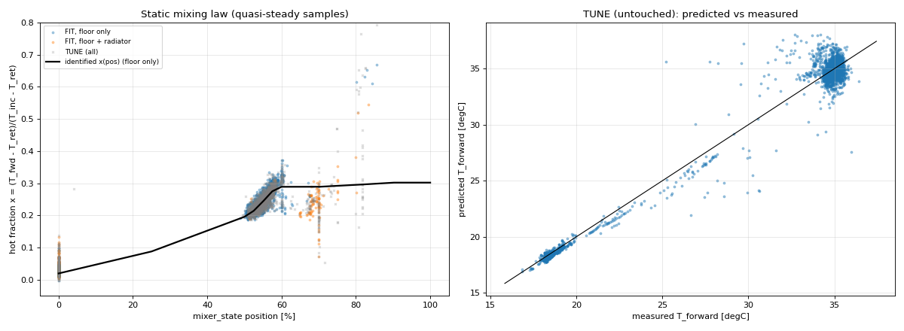
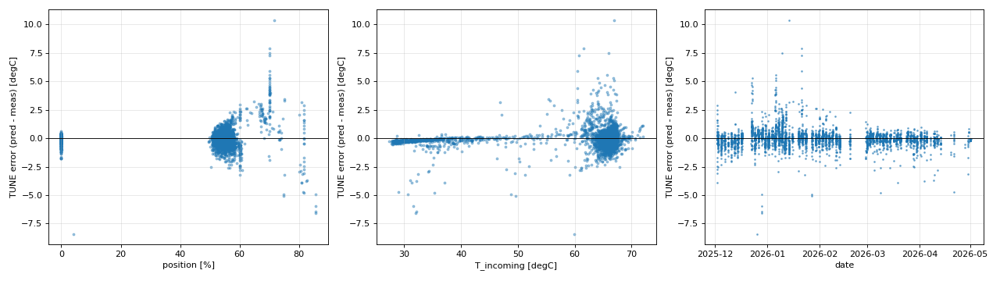

# Step 3 Report v1.0: 3-Way Mixer Static Mixing Characteristic

**Project:** ESP32 floor-heating HIL simulator - parameter extraction  
**Generated:** 2026-10-29 11:52:02 by `simulation/step3/step3_mixer_static_v1.py`  
**Git HEAD:** `78c8520e89b17d069c0ce049251f1e04b4746dbe`  
**Gates:** `step3/gates_step3.json` (SHA-256 `630854041c794554e20847123c1362b06181ed0d8532b73589d74c22fa05b429`, frozen before any step-3 analysis)

## 0. Summary

**TUNE (untouched) result: PASS**

| Gate | Threshold | Actual | Result | Margin |
|---|---|---|---|---|
| tune_steady_rmse_c | < 1.0 | 0.824 | PASS | +17.6% |
| tune_steady_abs_bias_c | < 0.3 | 0.009 | PASS | +97.0% |
| tune_steady_p95_abs_error_c | < 2.0 | 1.514 | PASS | +24.3% |

The mixer is modelled as an ideal 3-way mixing point: the forward temperature is the flow-weighted mix of the incoming (hot, fork) water and the floor return water,

```
T_fwd,ss = T_ret + x(pos) * (T_inc - T_ret)
```

with the hot fraction x a monotone piecewise-linear function of the dead-reckoned position (`mixer_state`).  Selected structure: **M1 monotone table** (2-fold week-parity cross-validation on FIT; the simplest model within 0.02 degC of the best CV RMSE).

## 1. Data and quasi-steady selection

* Heating season 10 s grid (causal zero-order hold, ages per signal), Step 1 pump debounce.
* FIT and TUNE are the 12-hour blocks of `step2/holdout_v7.json`.  Step 2 used TUNE only for T_incoming structure checks; T_forward was never fitted or used for decisions on TUNE, so TUNE is an untouched test set for this step.
* Quasi-steady sample (QS): over the trailing 300 s the floor pump is on, the mixer position varies by < 0.5 %, no DHW, the radiator-pump state is constant, T_inc and T_fwd ages <= 900 s, and mean(T_inc - T_ret) >= 10.0 degC.  Window means of T_inc, T_ret, T_fwd and position are used; one sample per 180 s.
* **Actuation/position-fault days:** a calendar day is excluded when any QS sample has mixer_state <= 1 % (valve reported closed) together with x > 0.15 - physically impossible for a closed valve (closed-valve QS samples are otherwise at x of a few hundredths).  Example (FIT, 2025-12-25): the legacy over-temperature slam drives the dead-reckoned position to 0 %, but T_forward stays near 38-40 degC for hours and the BMI160 alternates between two frozen values, i.e. the valve did not move.  No input-only signal identifies these days.  Excluded days - FIT: 2025-12-25, 2026-02-13, 2026-02-17, 2026-03-27, 2026-03-31; TUNE: 2026-01-25, 2026-02-14, 2026-02-16, 2026-02-20, 2026-02-22, 2026-02-24.  The rule is applied identically to FIT and TUNE and was fixed (script commit) before TUNE was evaluated; TUNE results without the rule are reported in Section 3.
* Samples after the rule: FIT 4,511 (of 4,920), TUNE 4,144 (of 4,700).

Position support (QS samples per position bin):

| mixer_state bin [%] | FIT | TUNE |
|---|---|---|
| (-0.01, 1.0] | 645 | 653 |
| (1.0, 10.0] | 0 | 1 |
| (10.0, 25.0] | 0 | 0 |
| (25.0, 40.0] | 0 | 0 |
| (40.0, 50.0] | 1 | 4 |
| (50.0, 52.5] | 453 | 458 |
| (52.5, 55.0] | 1858 | 1446 |
| (55.0, 57.5] | 1149 | 1152 |
| (57.5, 60.0] | 272 | 259 |
| (60.0, 65.0] | 33 | 32 |
| (65.0, 70.0] | 74 | 67 |
| (70.0, 80.0] | 18 | 39 |
| (80.0, 90.0] | 8 | 33 |
| (90.0, 100.0] | 0 | 0 |

The legacy PID parks the valve almost only at 0 % or around 50-60 %; the 1-45 % range is crossed only while moving (full stroke 145 s).  **x(pos) is data-supported only where the table above shows FIT samples**; between them it is a monotone linear interpolation, and it is refined with dynamic (moving-valve) data in Step 4.

## 2. Identification

x is parameterised on knots 0, 25, 50, 52.5, 55, 57.5, 60, 65, 70, 80, 90 % as x(0) plus non-negative increments (monotone non-decreasing), and fitted by bounded linear least squares on T_fwd - T_ret = x * (T_inc - T_ret) with Huber re-weighting (c = 1.0 degC) and a light second-difference smoothness penalty (weight equivalent to 10 samples per 10 % of travel), so that ranges without data are bridged by a smooth, nearly linear curve instead of an arbitrary step.  Candidate extras: a radiator-pump offset on x (radiator pumps change the pressure at the fork) and a dead-reckoning drift term on x growing linearly over the 12 h after the nightly re-zeroing (Step 1 found mixer_state - BMI160 rising from about +0.9 % to +1.8 % after a reset).

| Candidate | Free parameters | CV RMSE | CV MAE | CV bias | Chosen |
|---|---|---|---|---|---|
| M1 monotone table | 11 | 0.715 | 0.449 | 0.003 | yes |
| M2 monotone table + radiator factor | 12 | 0.701 | 0.448 | -0.006 |  |
| M3 monotone table + dead-reckoning drift | 12 | 0.717 | 0.454 | 0.006 |  |
| M4 monotone table + radiator factor + drift | 13 | 0.702 | 0.453 | -0.003 |  |

Identified law (final fit on all FIT samples):

| Knot position [%] | x | FIT QS samples within +/-2.5 % |
|---|---|---|
| 0 | 0.0197 | 645 |
| 25 | 0.0880 | 0 |
| 50 | 0.1957 | 2312 |
| 52.5 | 0.2144 | 3461 |
| 55 | 0.2435 | 3732 |
| 57.5 | 0.2751 | 3312 |
| 60 | 0.2891 | 1454 |
| 65 | 0.2891 | 107 |
| 70 | 0.2891 | 92 |
| 80 | 0.2950 | 26 |
| 90 | 0.3021 | 8 |


FIT in-sample: RMSE 0.670, MAE 0.425, bias 0.006 degC; 384 of 4511 samples were down-weighted by the Huber step.

Findings:

* **Leak-by:** x(0) = 0.020 - a closed valve still passes about 2 % hot water (supported by 645 samples).
* **Operating band:** x rises from 0.196 at 50 % to 0.289 at 60 %, i.e. about 0.0093 per % of travel.  A 2 % dead-reckoning error there shifts T_forward by about 0.7 degC at a 40 degC lift.
* **Above 60 % the law is not identified.** The fitted curve stays near 0.29-0.30, but this is a compromise between conflicting sparse data: with a radiator pump on at the legacy 70 % clamp the hot fraction is about 0.2, while the few floor-only samples at 80-90 % (low T_incoming) reach 0.6-0.8 (see the figure).  The values above 60 % must not be used as a physical saturation; Step 4 re-examines this range with moving-valve data.
* **Mid-range (1-45 %):** no quasi-steady data; the curve is the smooth bridge between 0 % and 50 % and is provisional until the dynamic identification in Step 4.



## 3. Test on TUNE (untouched)

TUNE: n = 4,144, RMSE 0.824, MAE 0.481, bias -0.009, P95 |error| 1.514, max |error| 10.387 degC.

Without the fault-day rule (all 4,700 TUNE QS samples): RMSE 1.041, bias -0.070, P95 1.627, max 13.290 degC - the gates would not all pass.  The gate result above uses the rule as frozen.

| Position band [%] | n | RMSE | Bias |
|---|---|---|---|
| (-0.01, 1.0] | 653 | 0.390 | -0.206 |
| (1.0, 45.0] | 1 | 8.397 | -8.397 |
| (45.0, 50.0] | 4 | 0.246 | -0.197 |
| (50.0, 55.0] | 1904 | 0.472 | 0.007 |
| (55.0, 60.0] | 1411 | 0.696 | -0.074 |
| (60.0, 65.0] | 32 | 1.618 | 0.109 |
| (65.0, 100.0] | 139 | 3.229 | 1.393 |

| Radiator pump | n | RMSE | Bias |
|---|---|---|---|
| 0 | 3321 | 0.643 | -0.044 |
| 1 | 823 | 1.322 | 0.133 |

| Month | n | RMSE | Bias |
|---|---|---|---|
| 2025-12 | 1070 | 0.893 | -0.049 |
| 2026-01 | 1338 | 1.019 | 0.186 |
| 2026-02 | 531 | 0.624 | -0.121 |
| 2026-03 | 916 | 0.492 | -0.116 |
| 2026-04 | 261 | 0.729 | -0.228 |
| 2026-05 | 28 | 0.144 | -0.139 |



## 4. Use in the HIL simulator and limitations

* The simulator evaluates x at the *physical* valve position.  The table is expressed in `mixer_state` (dead-reckoned) units; Step 1 found mixer_state = 0.9925 * BMI160 + 2.29 % when the accelerometer is not frozen, i.e. physical and dead-reckoned scales agree within about 2 %.
* Outside the supported bins the curve is a smooth monotone bridge and must be treated as provisional until Step 4.
* **Radiator pumps:** TUNE RMSE is 1.322 degC with a radiator pump on versus 0.643 degC without (bias 0.133 vs -0.044).  The radiator offset on x did not pass the cross-validation selection rule, so the mixing law is regime-independent; the larger scatter with radiators on reflects pressure/flow interactions at the fork that a static law does not capture.
* The legacy controller's fault days show that dead-reckoned position can be grossly wrong after an over-temperature slam; the new controller's encoder consistency check addresses this.  In the HIL the actuator position is known exactly.
* x is a steady-state quantity.  Transport delays, actuator travel and sensor lag are Step 4.

## 5. Reproduction

```bash
cd /home/gume/claude/HeatpumpsN && .venv/bin/python simulation/step3/step3_mixer_static_v1.py
```
