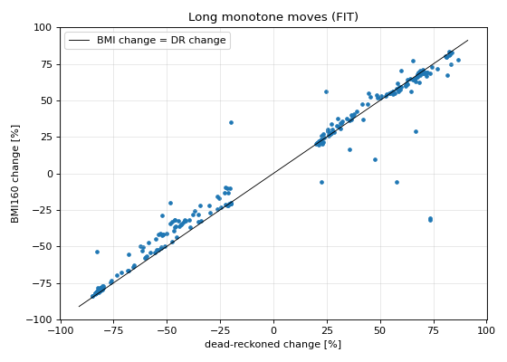
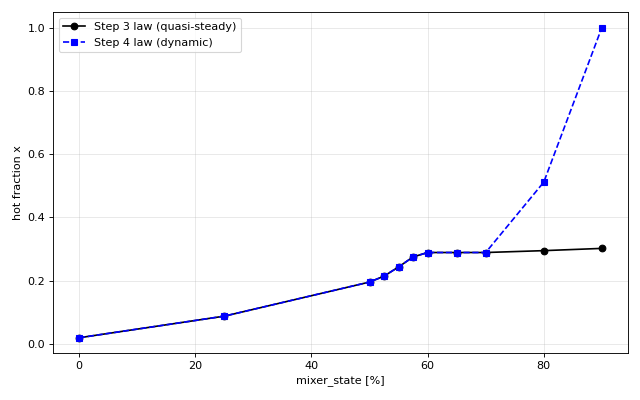
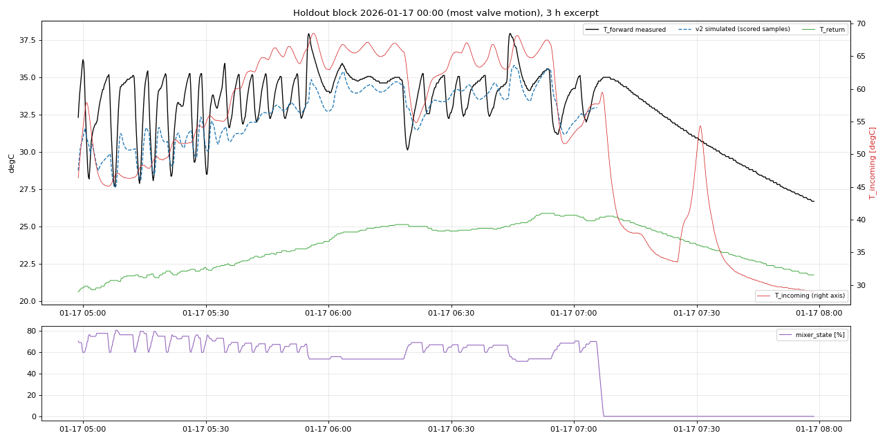

# Step 4 Report v2.0: Mixer Actuator, Transport Delay and Forward-Sensor Dynamics

**Project:** ESP32 floor-heating HIL simulator - parameter extraction  
**Generated:** 2026-10-29 14:01:58 by `simulation/step4/step4_mixer_dynamics_v2.py`  
**Git HEAD:** `ff20c0851ed571e4d4953fa5b82ce9080bace799`  
**Gates:** `step4/gates_step4.json` (SHA-256 `5e67fdab55b1a9a05fa195f4b7c1f320dce09341d5c65267ffc1862372cdff22`, frozen before any step-4 analysis)

## 0. Summary

**Test result (HO-1..HO-3, untouched for T_forward): FAIL**

| Gate | Threshold | Actual | Result | Margin |
|---|---|---|---|---|
| tune_pumpon_rmse_c | < 1.5 | 1.602 | FAIL | -6.8% |
| tune_pumpon_mae_c | < 1.0 | 1.098 | FAIL | -9.8% |
| tune_move_t50_median_abs_error_s | < 30.0 | n/a | NOT EVALUABLE (no qualifying events) - not passed | n/a |

History: v1.0 (Step 3 law, delay + sensor lag) was tested once on the TUNE blocks and **failed** the RMSE gate (1.545 degC vs < 1.5; MAE 0.832 passed; timing gate not evaluable).  FIT residual diagnostics then located most of the squared error above 60 % valve position, where the Step 3 law is not identified.  v2.0 adds candidates that re-estimate that range from moving-valve data and a radiator-pump effect.  Because TUNE had been seen, v2.0 is tested on the Step 2 holdout blocks, which no step has used for T_forward.  On TUNE (now observed) v2.0 reaches RMSE 1.285 and MAE 0.745 degC.

Identified dynamics (FIT):

* transport delay valve -> T_forward sensor: **40 s**
* T_forward sensor (thermowell) lag: **35 s**
* **radiator-pump effect:** while a radiator pump runs the hot fraction is multiplied by **0.793** (the radiator circuits draw from the same fork and lower the pressure available to the floor mixer)
* incoming temperature input: the incoming *water* temperature (Step 2 thermowell lag tau_s = 75 s removed from the sensor reading for identification)
* actuator: 100 % travel in 145 s (full-speed rate P95 0.691 %/s), confirmed by the BMI160 (median ratio 0.978).

## 1. Data and scoring

* Heating season 10 s grid, Step 1 pump debounce; FIT/TUNE/holdout blocks of `step2/holdout_v7.json`.
* Free-run simulation per block; the sensor state and delay line are re-anchored to the measured T_forward whenever the floor pump starts and follow the measurement while it is off.  Scored: floor pump on for >= 5 min, no DHW, fresh T_forward, T_incoming and T_boiler (age <= 900 s), outside the 30-min block warm-up and outside Step 3 fault days (FIT/TUNE: 2025-12-25, 2026-01-25, 2026-02-13, 2026-02-14, 2026-02-16, 2026-02-17, 2026-02-20, 2026-02-22, 2026-02-24, 2026-03-27, 2026-03-31; holdout: 2026-02-27).
* Scored samples: FIT 295,463, TUNE 282,216, holdout 2,765.

## 2. Actuator travel

Interior samples of moves give a median dead-reckoned rate of 0.266 %/s and a P95 of 0.691 %/s.  The firmware integrates relay time over a 145 s stroke, so full-speed travel is 0.690 %/s; the lower median comes from the short PID pulses (2-3 %) being spread over the time-quantised telemetry.  The physical travel was checked on 262 long monotone moves (>= 20 % dead-reckoned, BMI160 moved >= 5 %): median BMI change / DR change = 0.978 (IQR 0.934 - 1.005), confirming the 145 s stroke.  Backlash could not be resolved (accelerometer freezes, 0.1 % resolution).



## 3. Identification and structure selection (FIT only)

Delay on a 10 s grid (0-240 s); sensor lag, law knots and radiator multiplier by Nelder-Mead on the free-run mean squared error.  Law refinements keep monotonicity: below 50 % the interior knots move between the Step 3 anchors at 0 % and 50 %; above 60 % the knots rise monotonically from the Step 3 value at 60 %.  Selection: 2-fold week-parity CV on FIT, simplest candidate within 0.02 degC of the best.

| Candidate | CV RMSE | Fold delays [s] | Fold sensor lags [s] | Chosen |
|---|---|---|---|---|
| C1 measured T_inc, step-3 law | 1.444 | 0, 0 | 50, 43 |  |
| C2 reconstructed T_inc water, step-3 law | 1.337 | 20, 20 | 59, 50 |  |
| C3 measured T_inc, law refined below 50 % | 1.435 | 0, 0 | 55, 49 |  |
| C4 reconstructed T_inc water, law refined below 50 % | 1.321 | 20, 10 | 61, 62 |  |
| C5 C2 + law refined above 60 % | 1.315 | 20, 20 | 62, 54 |  |
| C6 C5 + radiator multiplier on x | 1.130 | 30, 30 | 48, 40 | yes |

| Knot [%] | x (Step 3, quasi-steady) | x (Step 4 final) |
|---|---|---|
| 0 | 0.0197 | 0.0197 |
| 25 | 0.0880 | 0.0880 |
| 50 | 0.1957 | 0.1957 |
| 52.5 | 0.2144 | 0.2144 |
| 55 | 0.2435 | 0.2435 |
| 57.5 | 0.2751 | 0.2751 |
| 60 | 0.2891 | 0.2891 |
| 65 | 0.2891 | 0.2891 |
| 70 | 0.2891 | 0.2891 |
| 80 | 0.2950 | 0.5115 |
| 90 | 0.3021 | 1.0000 |



FIT (in-sample): RMSE 1.127, MAE 0.681, bias -0.197, P95 2.649 degC.  Isolated valve moves meeting the timing-gate definition on FIT: 0.

## 4. Test on HO-1..HO-3 (untouched for T_forward)

Free run: RMSE 1.602, MAE 1.098, bias -0.400, P95 3.580 degC (n = 2,765).  Reference on the same samples - Step 3 static law, no delay, no lag, measured T_incoming: RMSE 2.283, MAE 1.537 degC.

**Timing gate:** no holdout valve move satisfies the frozen isolated-move definition (the legacy PID moves the valve by 2-3 % every one to two minutes, so 5 min of quiet before and 10 min after a >= 3 % move practically never occur; FIT has 0 and TUNE 0 such events).  The gate is reported as not evaluable and therefore not passed; response timing enters only through the free-run error, which includes every valve move.



## 5. Use in the HIL simulator and limitations

* Valve: moves at 100 %/145 s toward the commanded position; x(pos) from the final table (leak-by at 0 %), multiplied by 0.793 while a radiator pump runs.
* Forward temperature: Tmix from the Step 2 water temperature T and T_return, delayed by 40 s, then the sensor lag of 35 s.
* The floor-pump start transient (stagnant water in the forward pipe) is not modelled here: the first 5 minutes after a pump start are not scored.  Step 5 covers the floor loop.
* The law below 50 % is constrained only by transient data; above 60 % it is now estimated from moving-valve data but rests on fewer samples than the 50-60 % operating band.
* The timing gate could not be evaluated with the frozen definition; a future data set with deliberate step tests (new controller commissioning) would allow a direct check.

## 6. Reproduction

```bash
cd /home/gume/claude/HeatpumpsN && .venv/bin/python simulation/step4/step4_mixer_dynamics_v2.py
```
