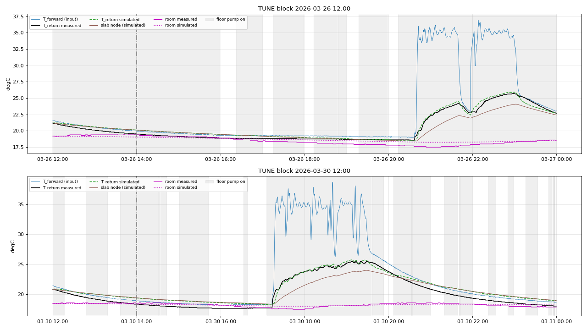

# Step 5 Report v1.0: Underfloor Loop, Slab and Room Dynamics

**Project:** ESP32 floor-heating HIL simulator - parameter extraction  
**Generated:** 2026-10-29 14:14:15 by `simulation/step5/step5_floor_slab_v1.py`  
**Git HEAD:** `0e5af0c307b3be0daad8817c765780e08703a200`  
**Gates:** `step5/gates_step5.json` (SHA-256 `584d59fbdc622efe664d2c2485aeb3d24c536a55e9f26690b9af05307b969d77`, frozen before any step-5 analysis)

## 0. Summary

**TUNE (untouched) result: PASS**

| Gate | Threshold | Actual | Result | Margin |
|---|---|---|---|---|
| tune_tret_rmse_c | < 1.0 | 0.690 | PASS | +31.0% |
| tune_tret_mae_c | < 0.6 | 0.552 | PASS | +8.0% |
| tune_tret_abs_bias_c | < 0.3 | 0.146 | PASS | +51.3% |
| tune_room_night_rmse_c | < 0.5 | 0.359 | PASS | +28.2% |

Selected structure: **S1 one node, no delay**.  Key identified quantities (FIT):

* slab charging time constant tau_in = 8308 s (2.31 h), driven by the loop temperature drop T_fwd - T_ret; slab-to-room loss time constant tau_out = 8412 s (2.3 h).  These hour-scale constants describe the fast screed/pipe layer that the return water sees, not the whole building mass; a second, slower node did not improve the cross-validated error (Section 3).
* return approach beta = 0.187 (return = slab + beta x (forward - slab)), return-sensor/loop mixing tau_r = 305 s
* pump off: return sensor relaxes with tau_off = 5041 s toward slab + 1.000 x (room - slab)
* room: coupling to slab tau_bs = 69778 s (19.4 h), to outdoors tau_bo = 250006 s (69.4 h), other net gain c0 = -0.089 K/h

## 1. Model

```
pump on : Tr -> Ts + beta*(Tfwd(t-d_s) - Ts)              (tau_r)
          Ts += DT*[(Tfwd(t-d_s) - Tr)/tau_in - (Ts - Troom)/tau_out]
pump off: Tr -> Ts + kappa*(Troom - Ts)                   (tau_off)
          Ts += DT*[-(Ts - Troom)/tau_out]
two-node: Ts += DT*(Tq - Ts)/tau_q ; Tq -= r_q * same
room    : Troom += DT*[(Ts - Troom)/tau_bs - (Troom - Tout)/tau_bo + c0]
```

The slab is identified with the measured room temperature as boundary; the room model is then identified with the simulated slab temperature as input.  In the HIL both run coupled.

## 2. Data and scoring

* FIT/TUNE 12-hour blocks of `step2/holdout_v7.json`; Step 1 pump debounce.  All states start at the measured T_return (slab nodes) and room temperature at the block start; the first 2 h are a warm-up and are not scored.
* Scored T_return samples: fresh T_forward and T_boiler (age <= 900 s), outside Step 3 fault days (2025-12-25, 2026-01-25, 2026-02-13, 2026-02-14, 2026-02-16, 2026-02-17, 2026-02-20, 2026-02-22, 2026-02-24, 2026-03-27, 2026-03-31).  T_return age is not required: Home Assistant de-duplicates unchanged DS18B20 values, so an old T_return report means an unchanged value.
* Room samples: 22:00-06:00 local only (no solar gain), room sensor age <= 3600 s.
* Blocks / samples: FIT 156 / 506,721 (room 147,752); TUNE 156 / 494,110 (room 144,961).

## 3. Identification and structure selection (FIT)

Differential evolution (seed 5) on the free-run T_return mean squared error; 2-fold week-parity CV on FIT (reduced search), simplest candidate within 0.02 degC of the best.

| Candidate | CV RMSE | CV MAE | Chosen |
|---|---|---|---|
| S1 one node, no delay | 0.702 | 0.562 | yes |
| S2 one node, transport delay | 0.725 | 0.561 |  |
| S3 two nodes, no delay | 0.702 | 0.563 |  |
| S4 two nodes, transport delay | 0.754 | 0.587 |  |

| Parameter | Value | Search range |
|---|---|---|
| `tau_r` | 305.039 | [10, 3000] |
| `beta` | 0.187155 | [0, 1] |
| `tau_in` | 8308.3 | [300, 200000] |
| `tau_out` | 8412.05 | [1000, 500000] |
| `tau_off` | 5040.76 | [60, 100000] |
| `kappa` | 1 | [-0.5, 1] |
| `d_s` | 0 | fixed (not in structure) |
| `tau_q` | 1e+09 | fixed (not in structure) |
| `r_q` | 0 | fixed (not in structure) |
| `tau_bs` | 69778.1 | [1000, 1e+06] |
| `tau_bo` | 250006 | [1000, 1e+06] |
| `c0` | -2.48343e-05 | [-0.0002, 0.0002] |

Boundary-limited parameters: `kappa`.  `kappa` = 1 means that with the pump off the return manifold water relaxes completely to the room temperature (it is a stagnant pipe in a heated room), not to the slab.  The room parameters are weakly identifiable: the room temperature moves by only about one degree per day, so tau_bs, tau_bo and c0 trade off against each other; the combination reproduces the night-time room temperature but the individual values should not be interpreted as building UA values.

FIT: T_return RMSE 0.691, MAE 0.555, bias 0.079, P95 1.328 degC; room (night) RMSE 0.386, bias 0.063 degC.

## 4. Test on TUNE (untouched)

T_return: RMSE 0.690, MAE 0.552, bias 0.146, P95 1.297 degC, median per-block RMSE 0.595 degC (n = 494,110).  Room (night): RMSE 0.359, bias 0.055 degC (n = 144,961).



## 5. Use in the HIL simulator and limitations

* Inputs in closed loop: simulated T_forward (Step 4), floor-pump relay, outdoor temperature (replayed or synthetic); the room temperature is simulated, so the slab model uses the simulated room in the HIL.
* The room sensor sits near a window; day-time solar gains are not modelled (night-only identification), so day-time room temperatures will be underestimated on sunny days.
* The slab state is latent; it is initialised from T_return.  The 12-hour blocks resolve time constants up to about a day; slower seasonal storage is not identified.

## 6. Reproduction

```bash
cd /home/gume/claude/HeatpumpsN && .venv/bin/python simulation/step5/step5_floor_slab_v1.py
```
