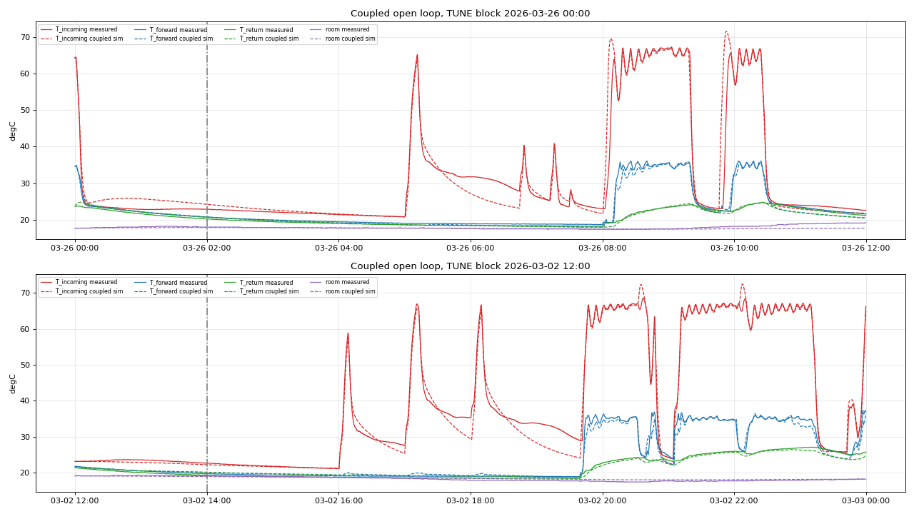
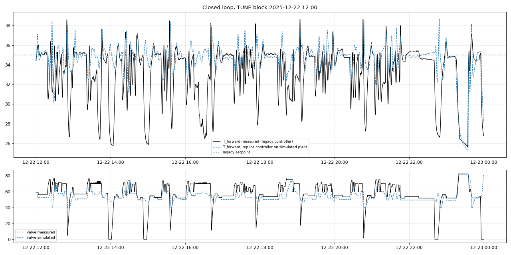

# Step 6 Report v1.0: Integrated HIL Plant Simulator and Validation

**Project:** ESP32 floor-heating HIL simulator - parameter extraction  
**Generated:** 2026-10-29 14:23:10 by `simulation/step6/step6_plant_validation_v1.py`  
**Git HEAD:** `9e96b7bbbb52b80ec7a71d4615ee79760d1edfc8`  
**Gates:** `step6/gates_step6.json` (SHA-256 `63281d063e0cafd00c9171376b306bec1c54c06945f51c469b55757d37790c91`, frozen before any step-6 code)

## 0. Summary

**Result: PASS** (8 of 8 gates pass)

| Gate | Threshold | Actual | Result |
|---|---|---|---|
| component_consistency_max_abs_c | < 1e-09 | 0 | PASS |
| cpp_parity_max_abs_c | < 1e-09 | 1.421e-14 | PASS |
| coupled_tinc_rmse_c | < 2.5 | 2.067 | PASS |
| coupled_tfwd_rmse_c | < 2 | 1.852 | PASS |
| coupled_tret_rmse_c | < 1.5 | 1.094 | PASS |
| coupled_room_night_rmse_c | < 0.8 | 0.4025 | PASS |
| closed_loop_tfwd_mean_abs_diff_c | < 1 | 0.5165 | PASS |
| closed_loop_pos_mean_abs_diff_pct | < 10 | 2.045 | PASS |

The plant model chains the identified sub-models of Steps 2-5 in one deterministic 10 s loop (`plant_v1.py`) and is ported to a header-only C++ class (`plant_v1.hpp`) for the ESP32 emulation backend or a host test bench.  No parameter was changed in Step 6; every value comes from the step parameter files (hashes in `step6_params_v1.json`) and is collected in `simulation/plant_parameters.json`.

## 1. Plant structure

```
inputs : boiler T_boiler, burner %, primary pump %, DHW flag   (replay or boiler emulator)
         pump relays P1, P2 (radiators), P3 (floor)             (controller under test)
         valve target (or position)                              (controller under test)
         outdoor temperature                                     (replay or synthetic)
valve  : travels at 100 % / 145 s toward the target
Step 2 : HX / fork water T and T_incoming sensor  <- T_return, T_room, valve, pumps, boiler
Step 3/4: Tmix = T_ret + x(pos)*m_rad*(T_inc,water - T_ret), delay, T_forward sensor lag
Step 5 : return water, slab node, room            <- T_forward, P3, outdoor
outputs: T_incoming (new controller's 'T_boiler' sensor position), T_forward (T_mix_out),
         T_return_floor, room, valve position
```

Plant-only assumptions (not identified in Steps 2-5): with the floor pump off the forward sensor relaxes like the stagnant return manifold (Step 5 tau_off, kappa); at a pump start the forward delay line holds the current forward-sensor value; coupled sub-models exchange T_return and T_room with a one-sample (10 s) lag.

## 2. Component consistency

On 6 FIT blocks with the most floor heating, the plant in component mode (every sub-model fed the measured inputs it was identified with) is compared with the original step implementations (`hx_model_v71.simulate`, `step4_mixer_dynamics_v2.simulate`, `step5_floor_slab_v1.sim_slab/sim_room`):

| Sub-model | Max abs difference [degC] |
|---|---|
| hx | 0 |
| mixer | 0 |
| tret | 0 |
| slab | 0 |
| room | 0 |

## 3. Coupled open-loop validation (TUNE)

Inputs: measured boiler signals, pump states, valve position and outdoor temperature.  All temperatures are simulated from the block start (initialised from measurements) without any re-anchoring; the first 2 h are a warm-up.  Blocks with a boiler-telemetry outage are not used (the HIL has no outages): 133 of 156 TUNE blocks.  Step 3 fault days excluded (2025-12-25, 2026-01-25, 2026-02-13, 2026-02-14, 2026-02-16, 2026-02-17, 2026-02-20, 2026-02-22, 2026-02-24, 2026-03-27, 2026-03-31).

| Signal | Samples | RMSE | MAE | Bias (sim - meas) | Scored when |
|---|---|---|---|---|---|
| T_incoming | 435,688 | 2.067 | 1.108 | -0.143 | fresh |
| T_forward | 226,755 | 1.852 | 1.193 | 0.092 | floor pump on >= 5 min, no DHW |
| T_return | 426,124 | 1.094 | 0.846 | 0.086 | all |
| room | 130,319 | 0.402 | 0.303 | 0.091 | 22:00-06:00 |



## 4. Closed-loop check with a legacy-controller replica

A Python replica of the legacy mixer logic (`analysis/OLD-CODE/heatpumps.yaml`: PID on T_forward with setpoint 35.0 degC, kp 0.005, kd 0.3, deadband +0.3/-0.5 K, 20 s update, 2 % residue accumulation; T_incoming-dependent maximum opening 70-90 %, 60 % when T_forward exceeds the setpoint; over-temperature slam to the minimum at setpoint + 3 K until setpoint - 1 K; close on floor-pump stop) drives the simulated valve while boiler signals and pump states are replayed.  Not modelled: stall check, nightly re-zeroing, HA setpoint changes (the setpoint used by HA is not logged; the firmware default is used).

| Quantity | Simulated | Measured |
|---|---|---|
| mean T_forward [degC] | 33.925 | 33.408 |
| std T_forward [degC] | 2.801 | 3.487 |
| mean valve position [%] | 58.255 | 56.211 |

Samples: 118,055 (floor pump on >= 30 min, no DHW, boiler fired within 10 min, TUNE).

The replica reproduces the regulated level around the setpoint and the operating valve band.  It does not reproduce the legacy controller's repeated valve slams to 0 % during heating (visible in the plot as T_forward dips to the return temperature; Step 1 classified most zero-position episodes as failsafe slams, and the stall check and pump-power glitches that trigger them are not replicated).  This is why the measured T_forward has a larger spread than the simulated one, and the mean-level gate should be read together with this difference: the plant is validated at the operating point, not for the legacy fault reactions.



## 5. C++ port and parity

`plant_v1.hpp` (class `hpn_plant::Plant`, one `step()` per 10 s) mirrors the coupled path of `plant_run` with actuator modes 0 (position replay) and 1 (target + 145 s travel).  The harness `plant_v1_harness.cpp` (g++ -O2 -std=c++17) reads parameters and inputs, prints %.17g; on 3 TUNE blocks x 2 modes (25,920 rows) the maximum absolute difference over all outputs is 1.42e-14.

## 6. Boiler emulator statistics (FIT)

For HIL runs without replayed boiler telemetry, a boiler emulator can be parameterised from these FIT statistics (not validated as a dynamic model):

| Quantity | Value |
|---|---|
| T_boiler during steady CH firing, P10 / median / P90 [degC] | 62.9 / 68.7 / 70.3 |
| burner modulation during steady CH firing, median [%] | 23 |
| burner on-time per firing (outside DHW), median / P90 [s] | 970 / 5720 |
| DHW events per day (FIT) | 3.2 |
| DHW duration median / P90 [s] | 1170 / 1626 |
| T_boiler peak during DHW, median [degC] | 81.5 |

## 7. Limitations

* The acceptance of the sub-models is mixed: Step 2 failed its frozen holdout (transitions and DHW), Step 4 failed its holdout narrowly, Steps 3 and 5 passed (reports in each step).  The coupled results above inherit these errors.
* The HIL plant reproduces the legacy operating envelope; behaviour far outside it (for example valve positions 10-45 % held for long periods, or new controller flush/pause strategies) relies on interpolated parts of the model.
* Room solar gains, radiator circuits' heat delivery and the boiler's internal control are not modelled; the boiler is an input (replay or emulator).

## 8. Reproduction

```bash
cd /home/gume/claude/HeatpumpsN && .venv/bin/python simulation/step6/step6_plant_validation_v1.py
.venv/bin/python simulation/collect_parameters.py
```
