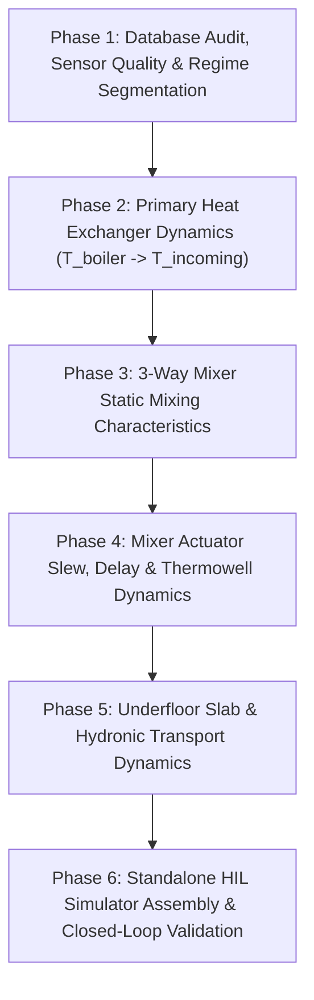

# Parameter Extraction & System Identification Plan
**Project:** ESP32 Floor Heating Hardware-in-the-Loop (HIL) Simulator  
**Location:** `/home/gume/HeatpumpsN/simulation/`  
**Document Version:** 2.1  
**Status:** Ready for Phase 1 Execution (Version 2 Audit)  

---

## 1. Project Goal & Overview

The objective of this parameter extraction process is to perform a clean-slate, bottom-up System Identification of the hydronic heating plant using historical telemetry stored in `/home/gume/HeatpumpsN/analysis/heatpumps.duckdb`.

The identified parameters will form the mathematical foundation of a deterministic, high-fidelity **Hardware-in-the-Loop (HIL) Floor Heating Simulator**. The simulator will enable testing, tuning, and validation of new ESP32 firmware control algorithms (replacing the legacy controller) before deployment on physical hardware.

---

## 2. Plant Physical Architecture & Operational Domain Knowledge

### 2.1 Hydraulic Plant Layout
* **Primary Heat Source (Boiler):**
  * Gas boiler with its own autonomous internal modulation and safety cutoff logic.
  * `boiler_curburnpow` represents **burner modulation percentage ($\%$, $0 - 100\%$)**, indicating how much burner capacity is utilized (not electrical Watts).
  * Operating temperatures: produces $\sim 80^\circ\text{C}$ supply during Domestic Hot Water (DHW) charging and $\sim 70^\circ\text{C}$ supply during space heating.
  * Internal throttling: The boiler may shut down or modulate down independently even if space heating demand is active, predominantly when heat cannot be dissipated into the loops (low hydraulic flow / high return temperature).
* **DHW Priority Mechanism:**
  * DHW charging (`binary_sensor.boiler_wwcharging`) takes absolute priority.
  * During DHW charging, all heated primary water is diverted away from the heating heat exchanger to the DHW cylinder. The heating heat exchanger receives zero heat.
* **Primary Heat Exchanger (HX) & Supply Fork:**
  * Primary loop from boiler through the plate heat exchanger is very short.
  * Immediately downstream of the secondary side of the heat exchanger is a hydraulic fork splitting into:
    1. **Radiator circuits:** Circulated by Pump 1 (`heatpumps_pump_1_power`) and Pump 2 (`heatpumps_pump_2_power`).
    2. **Underfloor heating (UFH) circuit:** Fed via a 3-way motorized mixing valve and circulated by Pump 3 (`heatpumps_pump_3_power`).
  * `mixer_incoming_temperature` ($T_{\text{incoming}}$) is physically located right at this fork.
* **Underfloor Heating (UFH) Loop:**
  * Total heated floor area is $\sim 70\,\text{m}^2$, divided into multiple parallel circuits across several rooms.
  * Supply and return water temperatures are measured at the central manifold:
    * `mixer_forward_temperature` ($T_{\text{forward}}$): Supply entering floor circuits after mixing.
    * `mixer_return_temperature` ($T_{\text{return}}$): Return collection manifold before re-entering mixer valve.
* **Summer Mode Exclusion:**
  * At the beginning of summer (mid-May 2026), the boiler was manually set to summer mode.
  * During summer, DHW remained active, but the heating controller's requests were unfulfilled by the boiler. Home Assistant automation commands during summer were unsupervised.
  * **Critical Rule:** Summer data (post May 18, 2026) must be completely excluded from space heating system identification. Parameter extraction must strictly target the verified **Heating Season (December 1, 2025 to May 18, 2026)**.

### 2.2 Sensor Characteristics, Firmware Filters & Fault Signatures
* **Temperature Sensors (Dallas DS18B20 1-Wire):**
  * Hardware ADC: 12-bit native resolution, providing a true physical quantization step of **$0.0625^\circ\text{C}$ ($1/16^\circ\text{C}$)**.
  * Firmware Filter (`OLD-CODE/temperature.yaml`): Polled at `10s` interval with `- or: [- delta: 0.1, - throttle: 60s]`. If $| \Delta T | \ge 0.1^\circ\text{C}$, it publishes every 10s. If $| \Delta T | < 0.1^\circ\text{C}$, updates are throttled.
  * Home Assistant Recorder Deduplication: Identical consecutive values are not written to the database. Missing/unchanged temperature records mean the temperature remained stable within the deadband; forward-fill is physically valid within active sessions.
* **Mixer Valve Position Tracking (Dual Complementary Sensors):**
  1. **Internal Actuator Timing Dead-Reckoning (`mixer_state`):**
     * Calculated in firmware by accumulating open/close relay pulse runtimes.
     * Subject to cumulative drift of $\sim 0.15 - 0.20\%$ per operating hour.
     * Maximum travel clamped by firmware limits (`mixer_maximum` at $\sim 89\%$).
     * Scheduled nightly re-zeroing: Clustered around midnight (`00:11 - 00:12`), driving the valve to $0.0\%$ to restore baseline calibration.
  2. **Rotary Knob Tilt Accelerometer (`mixermeter_bmi160_mixer_value`):**
     * Direct knob mechanical tilt calculation via BMI160 MEMS accelerometer.
     * **Fault Mode:** Randomly freezes and locks up, holding a static value for hours.
     * **Freeze Detection Criterion:** When `mixer_state` is actively moving ($> 3\%$ over 15 minutes) and `BMI160` remains static ($< 0.1\%$), the accelerometer is frozen.
     * **Concordance when Unfrozen:** When active, BMI160 closely tracks valve position ($R^2 \approx 0.89$, median offset $+1.6\%$).
* **Circulation Pump Power Meters & 2-Second Artifacts:**
  * `heatpumps_pump_1_power`, `heatpumps_pump_2_power` (Radiators), `heatpumps_pump_3_power` (Floor).
  * Firmware Filter (`OLD-CODE/power.yaml`): Updated in a 2-second loop. A firmware lambda filter enforced: `if (x < 5.0) return 0.0; else return x;` followed by `round: 0`.
  * **2-Second Glitch Mechanism:** Because pump running consumption is near $5.0\,\text{W}$, minor ADC noise oscillated across the hard $5.0\,\text{W}$ threshold, generating rapid 2-second alternating spikes and dropouts between $0\,\text{W}$ and $5\,\text{W}$.
  * **Critical Rule:** 2-second pump pulses are software/measurement artifacts, not physical pump operations. Telemetry must be debounced (using 1-minute windowed filtering) to prevent regime chatter.
  * The power meters are coarsely calibrated and serve primarily as binary indicators (`PUMP_ON` $\ge 2.0\,\text{W}$ vs `PUMP_OFF` $< 2.0\,\text{W}$).
* **Mixer Power Meter:**
  * Known to be invalid. Not present in the primary database; if encountered, it must be ignored.
* **Room Temperature Sensor (`temperature_humidity_sensor_d281_temperature`):**
  * Located in a room heated exclusively by floor heating, positioned near a window. Highly sensitive to solar radiation bias on sunny days.

### 2.3 Legacy Controller Firmware Artifacts
* **Failsafe Emergency Closures:** When radiator pumps switched states, sudden hydraulic pressure and temperature transients tripped safety limits. The legacy controller responded with emergency closures, slamming the valve to $0\%$ or minimum limit during active heating. These account for nearly half of all zero-state episodes and are firmware artifacts, not natural thermal dynamics.
* **Target Operation:** While the legacy system attempted time-of-day segregation to avoid concurrent radiator and floor heating, the new controller design will support cooperative concurrent operation.

---

## 3. Strict Rules of Engagement & Methodology

To ensure total reproducibility, mathematical rigor, and engineering reliability:

1. **Phase-by-Phase Gating:**
   * Work proceeds strictly one step at a time.
   * **Do not advance to the next step until all findings, queries, and outputs of the current step are reviewed and accepted.**
2. **Directory Isolation:**
   * **All execution scripts, data dumps, plots, and markdown reports must be written exclusively inside `/home/gume/HeatpumpsN/simulation/`.**
   * No files outside `simulation/` may be created or modified. Read-only access to `/home/gume/HeatpumpsN/analysis/` and `/home/gume/HeatpumpsN/firmware/` is allowed.
3. **Telemetry Hold Horizon & Outage Handling:**
   * Unconstrained Zero-Order Hold (ZOH / ASOF JOIN) across multi-day outages is strictly forbidden.
   * A maximum hold horizon (`max_hold_dt`) must be enforced:
     * Fast polled pumps: $180\,\text{s}$ ($3\,\text{mins}$).
     * Temperatures: $1,800\,\text{s}$ ($30\,\text{mins}$).
   * Periods exceeding hold horizons must be explicitly classified as **Regime O: Telemetry Outage / Offline** to prevent hallucinating multi-day continuous operations.
4. **Standalone Versioning:**
   * Every script and report must carry an explicit step and version tag (e.g., `step1_data_audit_v2.py`, `step1_data_audit_report_v2.md`).
   * When iterating, create a new version.
   * **New versions must be 100% self-contained and standalone.** Do not require the reader to cross-reference previous versions.
5. **Independent Verification:**
   * Any figures, formulas, or inferences derived from prior notes in `/home/gume/HeatpumpsN/analysis/` must be independently verified against the raw DuckDB database. Unverified prior claims cannot be assumed true.
6. **Full Reproducibility:**
   * Every report must document the exact script invocation, runtime parameters, data filtering logic, and mathematical formulations so that any result can be re-derived identically.
4. **Independent Verification:**
   * Any figures, formulas, or inferences derived from prior notes in `/home/gume/HeatpumpsN/analysis/` must be independently verified against the raw DuckDB database. Unverified prior claims cannot be assumed true.
5. **Full Reproducibility:**
   * Every report must document the exact script invocation, runtime parameters, data filtering logic, and mathematical formulations so that any result can be re-derived identically.

---

## 4. 6-Phase Master System Identification Plan

### Phase 1: Database Audit, Sensor Quality & Regime Segmentation
* **Objective:** Comprehensive schema inspection of `analysis/heatpumps.duckdb`, measurement intervals, threshold deadband effects, dual mixer sensor cross-validation, and operating regime segmentation.
* **Deliverables:** `step1_data_audit_v1.py`, `step1_data_audit_report_v1.md`.

### Phase 2: Primary Heat Exchanger Dynamics ($T_{\text{boiler}} \to T_{\text{incoming}}$)
* **Objective:** Model the heat transfer from boiler supply water through the plate heat exchanger to the common manifold fork.
* **Key Tasks:** Isolate space heating periods from DHW charging; quantify radiator pump cross-coupling effects on $T_{\text{incoming}}$ flow rate and temperature droop; establish the upstream thermal boundary condition for the mixer.

### Phase 3: 3-Way Mixer Valve Static Characteristic
* **Objective:** Determine the static mixing law relating valve position, incoming supply temperature, and return loop temperature to the mixed forward temperature:
  $$T_{\text{forward, steady}} = f(pos, T_{\text{incoming}}, T_{\text{return}})$$
* **Key Tasks:** Characterize valve hydraulic authority, non-linear flow geometry, leak-by at $0\%$, and heat exchanger balance during steady pump runs.

### Phase 4: Mixer Actuator & Sensor Dynamics ($pos \to T_{\text{forward}}(t)$)
* **Objective:** Quantify dynamic lag between actuator commands and observed forward temperature response.
* **Key Tasks:** Actuator motor slew rate ($\text{s}/100\%$), mechanical backlash/deadband, hydraulic transport delay from valve to sensor, and Dallas DS18B20 thermowell thermal time constant ($\tau_{\text{sensor}}$).

### Phase 5: Underfloor Slab & Hydronic Transport Dynamics ($T_{\text{forward}} \to T_{\text{return}}(t)$)
* **Objective:** Model the dynamic thermal response of the underfloor heating slab and piping circuits.
* **Key Tasks:** Transport delay estimation ($\tau_{\text{transport}}$ through the 70 m² pipe networks); lumped-parameter thermal capacitance ($C_{\text{slab}}$) and conductance ($R_{\text{slab}\to\text{room}}$); room thermal losses with window solar radiation bias rejection.

### Phase 6: Standalone HIL Simulator Assembly & Validation
* **Objective:** Integrate identified subsystems into a deterministic state-space simulator in Python / C++ compatible with the ESP32 firmware build system.
* **Key Tasks:** Validate open-loop and closed-loop performance against long historical telemetry continuous segments.

---

## 5. Specification for Step 1 Execution

When triggered, the Step 1 script (`step1_data_audit_v1.py`) will perform the following exhaustive audit:

1. **Schema & Coverage Analysis:**
   * Query DuckDB for all tables, views, and row counts.
   * Inspect timestamps: total duration, start/end dates, row counts per entity.
   * Distribution of time deltas ($\Delta t$): quantify reporting intervals, jitter, and Dallas sensor threshold deadband effects ($10\,\text{s}$ base, up to $60\,\text{s}$ throttle).
2. **Sensor Quality, Quantization & Health:**
   * Summary statistics: Min, Max, P5, P50, P95, Mean, StdDev, and NaN/NULL ratios for all primary entities.
   * Empirical quantization step: smallest observed non-zero difference between consecutive readings.
   * Mixer position sensor comparison: Cross-correlation between `mixer_state` and `mixermeter_bmi160_mixer_value`, identification of accelerometer freeze periods and nightly reset events.
3. **Operational Regime Segmentation:**
   * Categorize telemetry into distinct operating regimes based on pump powers and DHW status:
     * **Regime A (Floor Heating Only):** Floor Pump (Pump 3) ON, Radiator Pumps (1 & 2) OFF, DHW OFF.
     * **Regime B (Combined Heating):** Floor Pump ON, at least one Radiator Pump ON, DHW OFF.
     * **Regime C (Radiators Only):** Floor Pump OFF, Radiator Pumps ON, DHW OFF.
     * **Regime D (DHW Priority Charging):** DHW Active (`boiler_wwcharging` = 1).
     * **Regime E (Idle / Standby):** All pumps OFF, burner OFF, DHW OFF.
   * Calculate cumulative hours and identify continuous segments ($> 15\,\text{min}$) suitable for dynamic parameter identification.
4. **Deliverables:**
   * Standalone script: `/home/gume/HeatpumpsN/simulation/step1_data_audit_v1.py`
   * Standalone report: `/home/gume/HeatpumpsN/simulation/step1_data_audit_report_v1.md`
